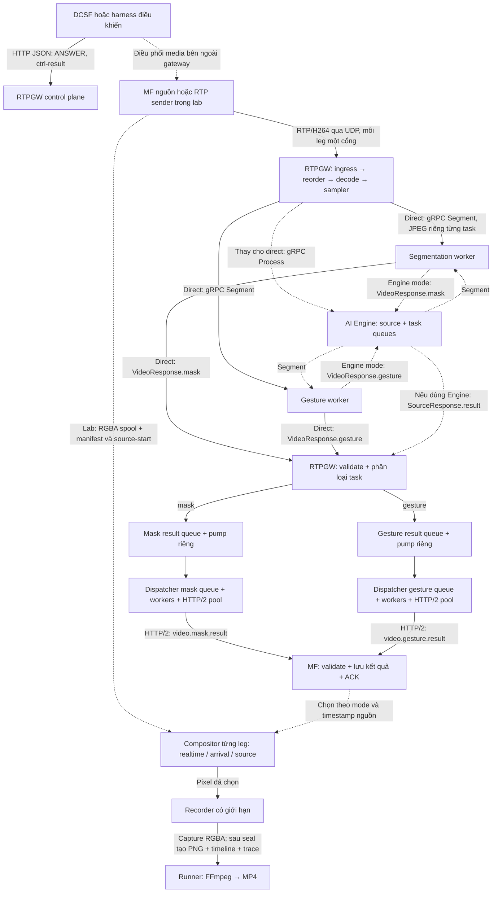
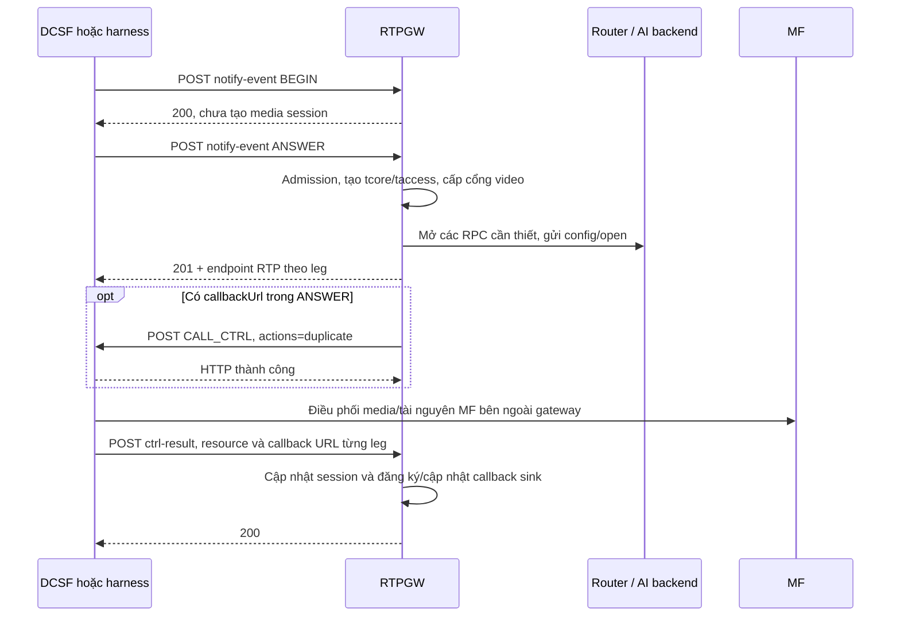
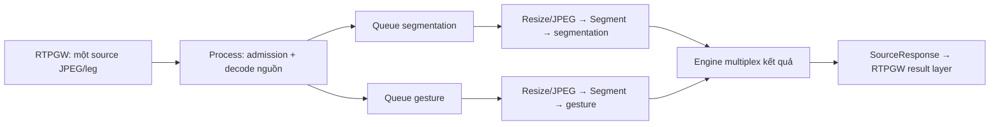
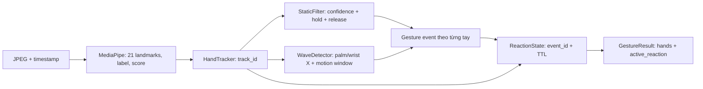
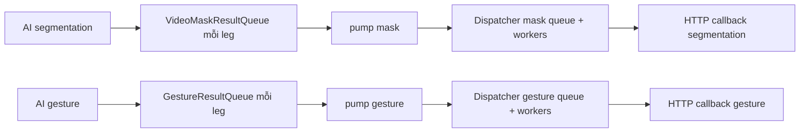
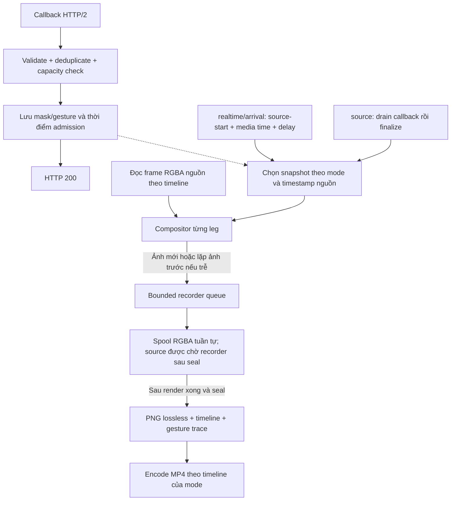
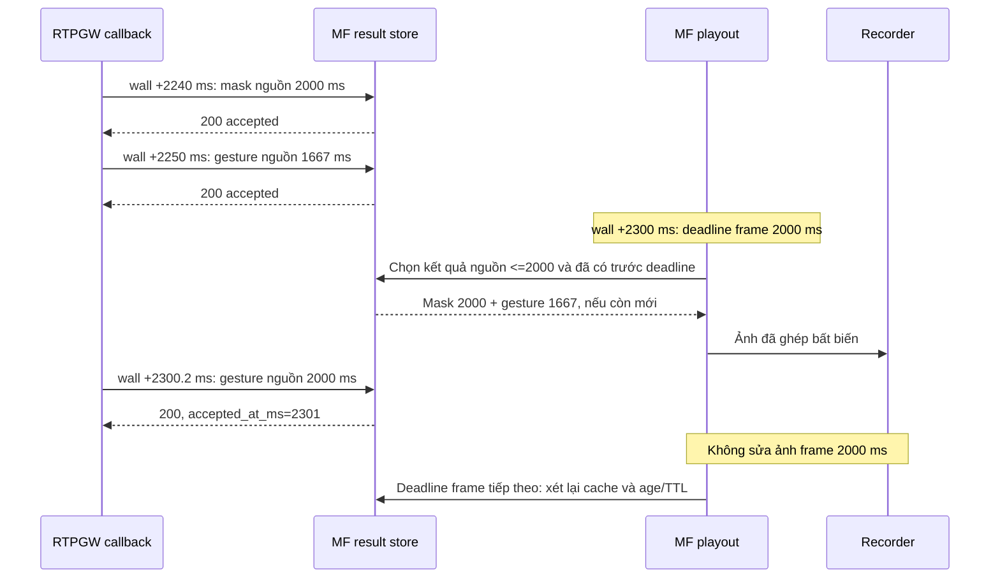
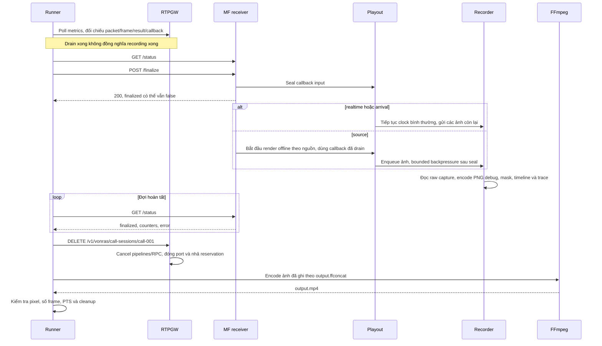

# Luồng điều khiển và dữ liệu video realtime: DCSF → RTPGW → AI → MF

Tài liệu mô tả code hiện tại cho segmentation/background replacement và gesture,
bao gồm MF realtime và các mode MP4 test `arrival`/`source`, queue/callback
riêng theo task và trace nhận/hiển thị gesture. Cập nhật ngày 2026-11-03.

## 1. Phạm vi và cách đọc

Có hai đường gọi AI đang được hỗ trợ:

- **Direct-worker:** RTPGW mở RPC riêng đến worker segmentation và gesture.
  `scripts/test-video-external-e2e.sh` dùng đường này, worker được khởi động riêng.
- **AI Engine:** RTPGW gửi một source stream/leg đến Engine; Engine phân phối
  độc lập đến hai worker. Bật bằng `video.ai.engine_target`.

Hai đường cùng trả về callback mask/gesture cho MF. Không cấu hình đồng thời
`engine_target` với các target direct-worker trong cùng cấu hình video AI.

MF C++ hiện tại là **MF lab, một call/process, hai leg** (`--legs 1` cho dịch vụ 1 leg:
gateway tcore → MF tAccess). Nguồn frame màu được
sender chuẩn bị trong `frames.rgba`/`frames.json`; PNG debug được xuất sau seal.
Clock nguồn được neo bằng API `/start`.
Mặc định `realtime` ghép theo deadline và ghi lại quyết định tại thời điểm phát.
Mode `arrival` cũng dùng clock, nhưng neo lifetime hiển thị reaction vào lần đầu
nhận event để đo độ trễ. Mode `source` đợi drain/seal rồi ghép cả mask và gesture
theo timeline nguồn. Chi tiết ở mục 12.4–12.5; ba mode đều là công cụ lab và giữ
nguyên protobuf, callback request, timestamp/epoch gốc. Chưa có nhận RTP/encode RTP
đầu ra hoặc playout audio tại MF lab. Điều phối DCSF/MF ngoài gateway được harness
mô phỏng; `/start`, `/status`, `/finalize` không phải API H.248 production.

Các JSON của **HTTP** dưới đây dùng tên trường thực tế, một số ví dụ chỉ trích
những trường cần giải thích. Các JSON mô tả **gRPC** là biểu diễn logic của
protobuf, không phải JSON thực sự truyền trên mạng hay ProtoJSON chuẩn. Dữ liệu
`bytes` trên gRPC là nhị phân, không phải chuỗi `<JPEG bytes>` trong ví dụ.

Mục lục:

1. [Phạm vi](#1-phạm-vi-và-cách-đọc)
2. [Kiến trúc](#2-kiến-trúc-và-trách-nhiệm)
3. [Phương thức truyền dữ liệu](#3-dữ-liệu-được-truyền-qua-đâu)
4. [Định danh và thời gian](#4-định-danh-và-các-đồng-hồ)
5. [Điều khiển cuộc gọi](#5-thiết-lập-cuộc-gọi-và-đường-callback)
6. [Nguồn và source-start](#6-chuẩn-bị-nguồn-và-neo-clock-mf-trong-lab)
7. [RTP và decode](#7-rtph264-đi-vào-rtpgw)
8. [gRPC direct-worker](#8-rtpgw-gọi-trực-tiếp-worker)
9. [gRPC qua Engine](#9-nhánh-ai-engine)
10. [Worker xử lý](#10-worker-xử-lý-dữ-liệu-nhận-được)
11. [Kết quả và callback](#11-từ-kết-quả-worker-đến-callback-mf)
12. [MF realtime](#12-mf-nhận-callback-và-ghép-theo-deadline)
13. [Giới hạn và lỗi](#13-queue-giới-hạn-tài-nguyên-và-lỗi)
14. [Kết thúc và MP4](#14-drain-seal-recording-và-xuất-mp4)
15. [Quan sát](#15-artifacts-và-cách-khoanh-vùng-lỗi)
16. [Chạy thử](#16-cấu-hình-và-kiểm-chứng)
17. [Source code](#17-đối-chiếu-source-code)

## 2. Kiến trúc và trách nhiệm



Các cạnh chấm qua Engine là đường thay thế, không phải gửi cùng một frame qua
cả direct và Engine. Ở đường Engine, kết quả worker quay về **Engine trước**, rồi
Engine bọc thành `SourceResponse` gửi về RTPGW.

| Module | Dữ liệu nhận | Công việc thực hiện |
| --- | --- | --- |
| DCSF/harness | Sự kiện call, endpoint RTP, tài nguyên MF | Chọn dịch vụ, điều phối duplicate media, báo callback URL theo leg |
| RTPGW control plane | HTTP JSON | Tạo/đóng session, cấp port, cập nhật sink và media resource |
| RTPGW video pipeline | RTP/H264 | Reorder/decode, giữ timestamp, lấy mẫu sau decode, resize/JPEG |
| WorkerRegistry/router | Task + capability | Chọn endpoint phù hợp, giữ/nhả slot RPC |
| AI Engine nếu bật | Source JPEG và config các task | Admission, credit, lấy mẫu/resize và queue riêng từng task |
| Segmentation worker | Config + JPEG | Decode JPEG, inference mask, threshold, encode RLE |
| Gesture worker | Config + JPEG | Landmarks/nhãn, tracking, static/Wave, reaction snapshot |
| RTPGW result layer | Kết quả AI | Validate/correlate, bổ sung resource và gửi callback |
| MF callback receiver | JSON mask/gesture | Validate, xử lý retry/conflict, lưu trước ACK |
| MF compositor | Source RGBA + cache AI + clock/mode | Realtime/arrival chọn tại deadline; source dựng sau seal, giữ timestamp nguồn |
| MF recorder | Ảnh đã chọn | Capture RGBA, sau seal xuất PNG, timeline và trace; không tham gia quyết định AI |
| Runner | Metrics/status/ảnh đã ghi | Drain, seal, đợi recorder, cleanup và encode/kiểm tra MP4 |

## 3. Dữ liệu được truyền qua đâu?

| Hop | Phương thức | Nội dung thực sự truyền |
| --- | --- | --- |
| DCSF → RTPGW | HTTP POST, JSON | BEGIN/ANSWER, selectedService, thông tin call |
| RTPGW → DCSF | HTTP POST, JSON khi có callback điều khiển | `callId`, `actions: duplicate`, URL nhận ctrl-result |
| DCSF → RTPGW | HTTP POST ctrl-result | Context/termination, callbackUrl từng leg và callbackUrls override theo task |
| MF nguồn/sender → RTPGW | UDP/RTP | Header RTP + H264 NAL/fragment, không phải JPEG/JSON |
| RTPGW → worker trực tiếp | gRPC bidirectional trên HTTP/2 | Protobuf `VideoRequest`: config rồi JPEG frame |
| RTPGW → Engine | gRPC bidirectional | `SourceRequest`: open, JPEG frame, close |
| Engine → worker | gRPC bidirectional | Config task và JPEG sau lấy mẫu/resize |
| Worker → RTPGW hoặc Engine | Chiều trả cùng RPC | `VideoResponse`: RLE mask hoặc snapshot gesture |
| RTPGW → MF | HTTP/2 POST JSON | `video.mask.result` hoặc `video.gesture.result`; không có ảnh nguồn |
| Sender → MF, chỉ lab | File cục bộ + HTTP/2 POST `/start/{leg}` | `frames.rgba`, `frames.json`; PNG debug sau seal; request start không cần body |
| Runner ↔ MF, chỉ lab | HTTP/2 GET/POST | `/status` và `/finalize` |
| MF → recorder | Queue trong cùng process | `Image`: width/height/channels + buffer RGBA và đường dẫn ghi |
| Recorder → FFmpeg | File PNG + ffconcat | Đúng ảnh đã chọn và timeline; FFmpeg encode H264/MP4 |

Callback sink RTPGW dùng HTTP/2: URL `http://` chạy h2c prior knowledge;
`https://` dùng HTTP/2 qua TLS. MF C++ lab bind loopback và nhận h2c. Các port
50052/50053/50054 là giá trị mẫu, không phải cố định của protocol.

## 4. Định danh và các đồng hồ

Ví dụ xuyên suốt: call `call-001`, leg tCore, nguồn 640×360; segmentation 5 FPS,
gesture 15 FPS, source video 30 FPS. Số frame trong ví dụ chỉ minh họa, không yêu
cầu ID liên tiếp sau lấy mẫu.

| Trường | Ví dụ | Phạm vi và cách dùng |
| --- | --- | --- |
| `callId` | `call-001` | API điều khiển cuộc gọi |
| `session_id` | `call-001-tcore` | Session nội bộ của leg |
| Stream video chuẩn | `call-001:tcore:video` | Source/gesture; mask callback hiện dùng stream ID dạng session |
| `media_epoch` | `media-001` | Thế hệ nguồn; dùng validate/correlate ở đường AI |
| `engine_epoch` | `engine-001` | Một lần mở Process, thay đổi khi reconnect |
| `recognizer_epoch` | `gesture-001` | Một recognizer/tracker gesture |
| `frame_id` | `61` | ID nguồn; không dùng để bắt hai task đợi cùng frame |
| `rtp_timestamp` | `1180000` | Timestamp RTP 32-bit, clock H264 90 kHz |
| `extended_rtp_timestamp` | `1180000` | Timestamp đã mở rộng để theo dõi qua wrap |
| `timestamp_ms` | `2000` | Media time từ mốc nguồn, không phải giờ máy |
| `seq` | `31` | Sequence kết quả; không so sequence giữa hai task |
| `track_id` | `1` | Một bàn tay trong stream/recognizer; không phải ID người dùng toàn hệ thống |
| `response_id` | `gesture-001/31` | Deduplicate snapshot gesture |
| `accepted_at_ms` | `2240` | Thời điểm MF lưu xong kết quả, tính từ clock source-start của leg |
| `deadline_ms` | `2300` | Deadline chọn kết quả cho frame có media time 2000 ms, buffer 300 ms |

Ba sự kiện khác nhau:

- `FrameAccepted` của Engine: nguồn được admit/fan-out; **chưa xong inference**.
- HTTP 200 từ MF: đã nhận/lưu callback; **chưa chắc frame đã được ghi**.
- `GET /status` có `finalized: true`: input đã seal, playout và recording hoàn tất.

MF hiện correlate mask bằng session/leg và timestamp; payload mask không có
`media_epoch`. Gesture có epoch nhưng receiver lab chủ yếu kiểm tra cấu trúc và
identity theo call/leg. Không coi đây là triển khai đầy đủ việc reset epoch giữa
call đang chạy của MF production. MF lab khởi tạo trạng thái mới theo process/call.

## 5. Thiết lập cuộc gọi và đường callback



### 5.1 BEGIN và ANSWER

```http
POST /v1/vonras/call-sessions/call-001/notify-event
Content-Type: application/json
```

```json
{
  "callId": "call-001",
  "event": "ANSWER",
  "selectedService": "change_background",
  "bearerCapability": "VIDEO",
  "callbackUrl": "http://dcsf:8080/v1/dcsf/call-sessions/call-001/call-control/dcas-1/key-1"
}
```

Gateway tra dịch vụ trong danh mục video (`video.services`, hoặc danh mục mặc định khi
dùng config cũ — xem [giai-phap-video-service-catalog.md](giai-phap-video-service-catalog.md)),
kiểm tra capacity, video.enabled, port pool và AI của chính dịch vụ đó còn slot (hết → 503);
tạo session theo `legs` của dịch vụ (`call-001-tcore`; thêm `call-001-taccess` nếu
`legs: both`, mặc định `tcore`),
listener và pipeline. Video-only không cần cấp port audio. Nếu tạo tài nguyên sau thất bại,
rollback tài nguyên đã tạo.

Mỗi dịch vụ dùng **đúng một AI service** (1 dịch vụ ↔ 1 AI):

- `change_background`: chỉ segmentation; mặc định chỉ leg tcore (`legs: tcore`), kết quả
  gửi về callback của tAccess theo ctrl-result single-leg. Không mở gesture.
- `video_effects`: chỉ gesture (AI task `gesture_recognition`, repo gesture), không segmentation;
  cũng chỉ leg tcore, kết quả gesture gửi về callback của tAccess như trên.
  `gesture_recognition` không còn là tên dịch vụ mặc định (gửi tên này → ACK 200 `{}`).
- Dịch vụ audio (`speech_to_text`, `realtime_translation`) không mở video kể cả khi
  `bearerCapability: VIDEO`. Dịch vụ tắt (`enabled: false`) hoặc lạ: ACK 200 `{}`.
- BEGIN trả 200, không tạo pipeline; service chưa hỗ trợ có thể được ACK 200 mà
  không tạo session. Không dùng riêng HTTP 200 để kết luận inference hoạt động.

Trích response ANSWER thành công của dịch vụ 1 leg (`change_background`, `video_effects`),
HTTP 201. Dịch vụ `legs: both` trả thêm `taccess_video_rtp_port` và
`taccess_local_non_dc_video_media`:

```json
{
  "session_id": "call-001",
  "status": "CREATED",
  "gateway_id": "gw-video-external",
  "rtp_ip": "127.0.0.1",
  "tcore_video_rtp_port": 41000,
  "tcore_local_non_dc_video_media": {
    "sdpmLine": "video 41000 RTP/AVP 96",
    "sdpaLines": ["rtpmap:96 H264/90000", "fmtp:96 packetization-mode=1;profile-level-id=42e01f", "sendrecv"]
  }
}
```

Đường direct đã gửi config, không có application readiness ACK riêng của worker.
Đường Engine chờ SourceOpened, nhưng đây cũng chỉ là admission/config sent, không
phải bằng chứng model đã trả kết quả.

### 5.2 CALL_CTRL nếu có callback điều khiển

RTPGW POST tới URL lấy từ ANSWER:

```json
{
  "callId": "call-001",
  "actions": "duplicate",
  "callbackUrl": "http://rtpgw:8081/v1/vonras/call-sessions/call-001/ctrl-result"
}
```

URL này bảo DCSF gửi kết quả điều khiển về gateway; không phải URL nhận mask hay
gesture. Gateway gửi CALL_CTRL bất đồng bộ sau response ANSWER; lỗi gửi điều
khiển dẫn tới đóng hai session. Harness E2E thường bỏ callback điều khiển và tự
POST ctrl-result, không kiểm chứng DCSF thật.

### 5.3 ctrl-result đăng ký tài nguyên và đích callback AI

```http
POST /v1/vonras/call-sessions/call-001/ctrl-result
Content-Type: application/json
```

```json
{
  "callId": "call-001",
  "mediaResources": {
    "tCore": {
      "contextId": "ctx-tCore",
      "termination": {"terminationId": "term-tCore"},
      "callbackUrl": "http://mf:9999/results/tCore"
    },
    "tAccess": {
      "contextId": "ctx-tAccess",
      "termination": {"terminationId": "term-tAccess"},
      "callbackUrl": "http://mf:9999/results/tAccess"
    }
  }
}
```

Gateway patch từng session, lưu resource, cập nhật HTTP callback sink và trả 200
khi tìm được session. `termination` ở request này là object; callback AI về sau
chứa resource dạng phẳng `terminationId`.

## 6. Chuẩn bị nguồn và neo clock MF trong lab

```mermaid
sequenceDiagram
    participant H as Runner
    participant S as RTP sender
    participant FS as File nguồn lab
    participant M as MF receiver
    participant P as MF playout / recorder
    participant R as RTPGW
    H->>S: Chạy sender với input và mf-start-url riêng leg
    S->>S: Encode/đọc H264, packetize, decode tham chiếu nguồn
    S->>FS: Ghi frames.rgba + frames.json, hoãn PNG debug
    S->>M: HTTP/2 POST /start/tCore, body rỗng
    M->>FS: Đọc/validate manifest, kích thước raw spool
    M->>P: Neo clock monotonic, mở recorder; playout theo mode
    M-->>S: 200 + trạng thái leg
    S->>R: Phát RTP theo media offset
    Note over P: realtime/arrival chạy clock; source đợi drain/seal mới render
```

Sender chỉ bắt đầu API start sau khi toàn bộ spool của leg đã chuẩn bị xong.
Thời gian dump nguồn không bị tính vào playout deadline. Leg còn lại POST
`/start/tAccess` và có origin riêng. Mode `source` vẫn dùng origin để đo thời điểm
nhận callback nhưng chưa render trước khi seal.

Ví dụ `output/tcore/frames.json`, hai frame đầu:

```json
[
  {"file":"source/000001.png","rtp_timestamp":1000000,"time_sec":0,"width":640,"height":360,"rgba_offset":0},
  {"file":"source/000002.png","rtp_timestamp":1003000,"time_sec":0.033333333,"width":640,"height":360,"rgba_offset":921600}
]
```

`frames.rgba` là các buffer RGBA8 nối liên tiếp, mỗi frame `640×360×4 = 921600`
byte, stride `width×4`, không có header hay protobuf. Offset phải liên tục và
kích thước file phải bằng tổng số byte frame. PNG nguồn được MF export sau seal từ cùng pixel RGBA để kiểm tra; MF không decode PNG đó trong luồng playout mới. Renderer giữ
một số buffer hữu hạn, không load toàn clip vào RAM. Fixture cũ không có offset
vẫn có thể dùng PNG fallback, nhưng chi phí decode có thể làm trễ lịch phát.

Start là idempotent trong cùng leg/process: gọi lại không reset origin. MF trả
409 khi nhận callback cần render trước khi source của leg đã start. Đây là API
của adapter lab; MF production cần lấy clock/frame từ media plane thực tế.

## 7. RTP/H264 đi vào RTPGW

Một RTP packet không tương đương một frame ảnh. Một frame H264 có thể gồm nhiều
NAL và nhiều packet. Ví dụ header của packet cuối một frame:

| Trường | Giá trị minh họa | Xử lý |
| --- | --- | --- |
| Version | 2 | Kiểm tra RTP hợp lệ |
| Payload type | 96 | Dynamic PT cho H264 theo SDP |
| Sequence number | 1000 | Reorder/phát hiện mất packet; wrap 16-bit |
| Timestamp | 1180000 | Chung cho các packet thuộc frame; clock 90 kHz |
| SSRC | 88001 | Định danh nguồn RTP |
| Marker | 1 | Đánh dấu cuối access unit theo sender |
| Payload | H264 bytes | Single NAL, STAP-A hoặc FU-A tùy packetization |

RTPGW thực hiện:

1. Listener trên port của leg nhận UDP, parse RTP và đưa vào pipeline đúng session.
2. Reorder/jitter theo sequence; chuyển packet hợp lệ cho decoder. Jitter video cấu
   hình riêng ở `video.jitter` (mặc định bật): gói thiếu được chờ `buffer_ms` kể từ lúc
   gói đứng sau khoảng trống đến, hết hạn thì bỏ qua cả khoảng trống một lần (mất 20 gói
   liên tiếp: jitter đứng ~270 ms thay vì ~2 s như thuật toán audio).
3. Reassemble/decode H264 bằng decoder riêng của session, giữ RTP timestamp. Sequence
   đứt (mất gói) → bỏ AU dở và mọi slice tới IDR kế tiếp; RTPGW không gửi PLI/FIR nên
   thời gian mất hình phụ thuộc chu kỳ IDR của nguồn. Đo bằng `media_ai_video_decoder_*`.
4. Gán source frame identity, quy đổi media timestamp và mở rộng RTP timestamp.
5. Lấy mẫu **sau decode** theo task/source FPS, resize và encode JPEG.

Không drop tùy ý compressed P-frame trước decode để giảm FPS AI. Decode vẫn phải
xử lý reference chain; sampler chỉ chọn decoded frame. Một decoder không được gọi
concurrent từ nhiều worker. Queue AI có giới hạn; chính sách drop tùy nhánh/cấu
hình, không đồng nghĩa mọi queue trong hệ thống có cùng policy.

## 8. RTPGW gọi trực tiếp worker

RPC thực tế là **`/video.VideoStream/Segment`**, bidirectional trên HTTP/2. Tên
Segment vẫn dùng cho gesture vì chung schema và chọn task bằng config.
Trong `video.proto`, khai báo Segment hiện được comment; runtime đăng ký/gọi
method qua handler và constant riêng. Xem `internal/ai/proto/method.go` cùng
contract Python; không suy ra RPC không tồn tại từ việc không thấy stub sinh tự động.

### 8.1 Config đầu stream

Đường segmentation gửi ví dụ:

```json
{
  "session_id": "call-001-tcore",
  "stream_id": "call-001-tcore",
  "config": {
    "effect_type": "bg_replace",
    "inference_width": 256,
    "inference_height": 256,
    "inference_fps": 5,
    "threshold": 0.5,
    "ai_service": "segmentation",
    "input_format": "jpeg"
  }
}
```

Gesture gửi trên RPC riêng:

```json
{
  "session_id": "call-001-tcore",
  "stream_id": "call-001:tcore:video",
  "config": {
    "selected_service": "change_background",
    "ai_service": "gesture_recognition",
    "media_epoch": "media-001",
    "input_format": "jpeg",
    "inference_fps": 15,
    "max_hands": 4
  }
}
```

Gesture có thể để inference dimensions bằng 0 và kiểm tra kích thước từng JPEG;
RTPGW giới hạn cạnh lớn nhất, giữ aspect ratio. Segmentation dùng kích thước
inference cấu hình, ví dụ vuông 256×256. `video_segment` là tên task trong registry,
còn `segmentation` là tên AI service trong config trên wire.

### 8.2 Frame sau config

Ví dụ frame gửi gesture:

```json
{
  "session_id": "call-001-tcore",
  "stream_id": "call-001:tcore:video",
  "frame": {
    "frame_id": 61,
    "rtp_timestamp": 1180000,
    "extended_rtp_timestamp": 1180000,
    "timestamp_ms": 2000,
    "original_width": 640,
    "original_height": 360,
    "width": 640,
    "height": 360,
    "encoding": "jpeg",
    "image_data": "<JPEG bytes>"
  }
}
```

Với segmentation của cùng nguồn, JPEG `width/height` là 256×256; original size và
identity vẫn chỉ nguồn gốc. Hai task có thể chọn các tập frame khác nhau. Một call
hai leg bật hai task có bốn RPC task, không nhất thiết bốn TCP connection vì gRPC
có thể multiplex trên HTTP/2.

Ở nhánh direct gesture, RTPGW giữ metadata của tối đa 128 frame đã gửi đang chờ
kết quả, không giữ JPEG trong bảng này. Khi đủ 128, sender của riêng stream đó
chờ một kết quả để giải phóng chỗ hoặc chờ context bị hủy. Không xóa metadata
của frame chưa có phản hồi: worker trả chậm vẫn phải đối chiếu được identity,
timestamp và geometry. Áp lực được đẩy về queue input hữu hạn của task; queue
này có thể loại frame chưa gửi theo chính sách hiện có. Đây là giới hạn khác với
queue kết quả và queue callback, không phải cam kết latency realtime.

## 9. Nhánh AI Engine



RPC là **`/video.VideoAIService/Process`**. Message đầu là SourceOpen:

```json
{
  "open": {
    "session_id": "call-001-tcore",
    "stream_id": "call-001:tcore:video",
    "media_epoch": "media-001",
    "selected_service": "change_background",
    "input_fps": 5,
    "input_max_dimension": 640,
    "segmentation": {"ai_service":"segmentation","selected_service":"change_background","media_epoch":"media-001","input_format":"jpeg","inference_width":256,"inference_height":256,"inference_fps":5,"effect_type":"bg_replace"}
  }
}
```

Theo quy tắc 1 dịch vụ ↔ 1 AI, RTPGW chỉ khai báo **một** task trong SourceOpen:
`change_background` chỉ có `segmentation`; `video_effects` chỉ có `gesture`, ví dụ
`"gesture": {"ai_service":"gesture_recognition","selected_service":"video_effects","media_epoch":"media-001","input_format":"jpeg","inference_width":640,"inference_height":0,"inference_fps":15,"max_hands":4}`
với `input_fps` 15. Engine vẫn hỗ trợ nhiều task/source như sơ đồ trên, nhưng gateway
không ghép hai AI vào một dịch vụ.

Ở SourceOpen, gesture inference_width là cạnh tối đa, inference_height phải bằng
0; đây chưa phải kích thước JPEG cố định gửi cho worker. Media epoch của mỗi
config task phải khớp epoch nguồn.

Engine reserve tập task của một source, mở backend RPC và gửi config. SourceOpened
trả tập task và credit window. Ví dụ payload của các SourceResponse:

```json
{"opened":{"tasks":["segmentation","gesture_recognition"],"max_inflight":8}}
```

```json
{"accepted":{"frame_id":61}}
```

Các số credit là minh họa. Envelope đầy đủ còn có session/stream/media epoch và
engine epoch. Request tiếp theo mang `frame` theo VideoFrame ở mục 8, không cần
bọc VideoRequest của từng task.

Engine decode JPEG nguồn một lần cho fan-out, lấy mẫu/resize riêng, queue có giới
hạn và xử lý model độc lập. Worker backend **vẫn decode JPEG riêng**; đây không
phải zero-copy hay một model runtime dùng chung bộ nhớ với worker Python.

`FrameAccepted` hoàn lại credit sau admit/fan-out, không chờ inference. Mỗi frame
nguồn có thể có 0, 1 hoặc 2 kết quả, không có barrier đợi đủ mask và gesture.
Nếu một task lỗi, Engine có thể gửi:

```json
{"task_status":{"ai_service":"gesture_recognition","status":"failed","error_message":"worker inference timeout"}}
```

Task còn lại tiếp tục theo lifecycle Engine. Trạng thái task và ACK không được
chuyển thành callback mask/gesture. Source network failure ảnh hưởng các task trên
source; reconnect đổi engine attempt. Hai leg dùng hai source RPC và bốn task RPC.

## 10. Worker xử lý dữ liệu nhận được

### 10.1 Segmentation

Worker kiểm tra config đầu stream, effect/input format và metadata; decode JPEG
BGR→RGB rồi gọi MediaPipe ImageSegmenter LIVE_STREAM. Kết quả confidence plane được
threshold thành foreground/background. Callback native phải khớp timestamp đang
chờ; quá thời gian `mediapipe.result_timeout_secs` kết thúc RPC bằng lỗi.

Mask nhị phân được RLE theo row-major: run đầu là background 0, tiếp theo foreground
1, luân phiên; tổng run bằng width×height. Worker trả VideoResponse theo từng
frame đã xử lý, echo frame ID và RTP timestamp. `latency_ms` là số đo phía worker,
không phải end-to-end latency hoặc tuổi mask lúc MF dùng.

### 10.2 Gesture static và dynamic



Worker kiểm tra JPEG/dimensions, frame ID và media time tăng đơn điệu, giới hạn
recognizer/max hands, rồi chờ callback MediaPipe cho từng frame. Timeout nội bộ
`gesture.result_timeout_secs` khác HTTP callback timeout và drain timeout.

- **Static:** label được mapping và đủ `static_score_threshold`, giữ đủ thời gian/
  số mẫu mới phát event. Latch/release/cooldown ngăn phát lặp khi giữ nguyên tư thế.
- **Wave:** detector riêng từng track, chọn tâm lòng bàn tay hoặc cổ tay; làm mượt
  theo media time, chuẩn hóa chuyển động theo kích thước tay và sàn chống nhiễu.
  `hysteresis` đếm lượt đảo chiều đủ biên độ; `steps` đếm đổi dấu bước đủ lớn và
  kiểm tra tổng span. Confidence Open_Palm dùng `wave.open_palm_score_threshold`.
- Mất tay reset lịch sử chuyển động, giữ cooldown khi track còn tồn tại. Wave được
  ưu tiên hơn static trên cùng tay; không chặn event tay khác.
- ReactionState tạo/giữ reaction theo thời hạn rồi đưa vào snapshot. Snapshot
  `hands: []` hoặc tay không có reaction vẫn là kết quả hợp lệ cần gửi để cập nhật.

Mặc định code là `palm/hysteresis`; muốn dùng `steps` phải đặt trong config đang
chạy và cập nhật package deployment. Upgrade giữ YAML hiện có, không tự đổi
thuật toán. Xem [Wave evaluation](https://github.com/chuhuutiennam/gesture/blob/main/docs/wave-evaluation.md) trong repo gesture.

## 11. Từ kết quả worker đến callback MF

### 11.1 Kết quả gRPC

Segmentation, ví dụ mask 256×256 toàn foreground để payload ngắn nhưng vẫn hợp lệ:

```json
{
  "session_id":"call-001-tcore",
  "stream_id":"call-001-tcore",
  "is_final":true,
  "mask":{
    "frame_id":61,"rtp_timestamp":1180000,
    "mask_width":256,"mask_height":256,
    "rle_counts":[0,65536],"latency_ms":28.4,"status":"ok"
  }
}
```

Mask thật của hình người có nhiều run. Không diễn giải ví dụ toàn foreground là
model luôn trả toàn bộ ảnh foreground. Gesture trả VideoResponse có `gesture`
thay vì `mask`, `ai_service: gesture_recognition` và sequence. Ví dụ một snapshot
trước đó, chưa thấy tay:

```json
{
  "session_id":"call-001-tcore",
  "stream_id":"call-001:tcore:video",
  "ai_service":"gesture_recognition",
  "seq":30,"is_final":false,
  "gesture":{
    "media_epoch":"media-001","recognizer_epoch":"gesture-001",
    "response_id":"gesture-001/30",
    "frame_id":59,"rtp_timestamp":1174000,"extended_rtp_timestamp":1174000,
    "timestamp_ms":1933,"original_width":640,"original_height":360,
    "status":"ok","hands":[]
  }
}
```

Snapshot không có tay vẫn được truyền và đếm như một kết quả. Snapshot có reaction
dùng cùng cấu trúc, minh họa đầy đủ ở callback HTTP bên dưới; gateway không tự
chạy lại inference để biến protobuf này thành JSON.

RTPGW validate loại task, source identity và đối chiếu frame đang chờ. Đường Engine
kiểm tra thêm engine/media epoch và metadata nguồn. Kết quả mask được map về
legacy stream ID dạng session, gesture giữ canonical stream ID. Sau đó coordinator
bổ sung resource, đẩy vào Result Dispatcher và HTTP callback sink.

Mỗi leg có `VideoMaskResultQueue` và `GestureResultQueue` riêng, mỗi queue có
pump riêng. Dispatcher có ba bounded queue và ba worker pool độc lập cho
`default` (audio), `video_segment` và `gesture_recognition`. Timeout/retry của
segmentation không chiếm worker của gesture. `result.dispatcher_workers` và
`result.queue_size` áp dụng **cho mỗi nhánh**, nên tổng worker/capacity là ba lần
giá trị cấu hình. Pool kết nối HTTP/2 cũng riêng theo task, reuse theo host
trong từng task và shared callback client. MF ACK nhanh làm việc gửi không phụ thuộc tốc độ ghi PNG. Số
callback không đồng nghĩa số frame output: video 30 FPS có thể dùng mask 5 FPS và
gesture 15 FPS mà vẫn ghi 30 frame/giây.

### 11.2 Callback segmentation: HTTP/2 POST `/results/tCore`

```json
{
  "event_type":"video.mask.result",
  "contextId":"ctx-tCore",
  "terminationId":"term-tCore",
  "session_id":"call-001-tcore",
  "stream_id":"call-001-tcore",
  "source_type":"raw_rtp",
  "kind":"video_mask",
  "text":"",
  "is_final":true,
  "ts_start":2000,"ts_end":2000,"seq":0,
  "mediaResources":{"tCore":{"contextId":"ctx-tCore","terminationId":"term-tCore"}},
  "video_mask":{
    "frame_id":61,"rtp_timestamp":1180000,
    "mask_width":256,"mask_height":256,
    "rle_counts":[0,65536],"latency_ms":28.4,"status":"ok"
  }
}
```

Các trường text/timing/seq thuộc envelope dùng chung và có thể là giá trị mặc
định tùy đường xử lý. Correlation mask dùng video_mask, không dùng text/seq.
`is_final: true` của mask không phải EOS cuộc gọi và không yêu cầu MF finalize.

### 11.3 Callback gesture: event riêng, URL theo leg hoặc override task

```json
{
  "event_type":"video.gesture.result",
  "contextId":"ctx-tCore",
  "terminationId":"term-tCore",
  "session_id":"call-001-tcore",
  "stream_id":"call-001:tcore:video",
  "source_type":"raw_rtp",
  "kind":"video_gesture",
  "ai_service":"gesture_recognition",
  "text":"","is_final":false,
  "ts_start":2000,"ts_end":2000,"seq":31,
  "mediaResources":{"tCore":{"contextId":"ctx-tCore","terminationId":"term-tCore"}},
  "gesture_result":{
    "media_epoch":"media-001",
    "recognizer_epoch":"gesture-001",
    "response_id":"gesture-001/31",
    "frame_id":61,"rtp_timestamp":1180000,"extended_rtp_timestamp":1180000,
    "timestamp_ms":2000,"original_width":640,"original_height":360,"status":"ok",
    "hands":[{
      "track_id":1,"handedness":"Right",
      "raw_label":"Open_Palm","raw_score":0.72,"stable_label":"",
      "center":[0.50,0.55],"bbox":[0.40,0.35,0.60,0.70],
      "active_reaction":{
        "event_id":"event-wave-1","gesture":"Wave","emoji_key":"wave",
        "started_at_ms":2000,"valid_until_ms":3500
      }
    }]
  }
}
```

Không gửi 21 landmarks sang MF trong contract này. MF nhận vị trí normalized và
reaction đã quyết định, không tự chạy lại detector Wave. `raw_label: Open_Palm`
không tự tạo sticker nếu thiếu active_reaction. Callback không chứa frame JPEG
hoặc buffer RGBA nguồn.

### 11.4 MF validate/lưu và ACK

MF kiểm tra event/kind, session/stream đúng leg, media resource không rỗng, frame
timestamp có trong manifest. Mask kiểm tra status, dimensions và tổng RLE;
gesture kiểm tra epoch/response ID, dimensions, track IDs, tọa độ và TTL reaction.

Mask retry được đối chiếu bằng frame ID/nội dung; gesture bằng response ID/nội
dung. Cùng ID nhưng payload mâu thuẫn bị từ chối. Receiver không gọi compositor,
không decode ảnh nguồn hoặc ghi PNG trong bước lưu callback.

Ví dụ HTTP 200 body:

```json
{
  "duplicate": false,
  "accepted_at_ms": 2240,
  "queued": true,
  "frames_written": 57,
  "realtime": true,
  "source_media_ms": 2000,
  "receive_lag_ms": 240,
  "playout_media_at_receive_ms": 1940,
  "gesture_render_mode": "realtime"
}
```

Thời điểm accepted_at được ghi sau khi lưu xong, làm tròn **lên** millisecond để
kết quả đến `deadline + 0.2 ms` không bị báo nhầm là đã đến đúng deadline.
`frames_written` chỉ là tiến độ capture raw của recorder lúc ACK, không cam kết
đã có PNG hoặc đã ghi frame của callback này. Trong `mf-events.jsonl`, metadata ACK vẫn nằm dưới khóa `render`
để tương thích reader; nó không còn chứa lời hứa PNG phải có trước ACK.

Metadata này là body response MF → RTPGW; không đổi payload callback request
mask/gesture ở mục 11.2–11.3. `realtime` trong ACK là false ở mode `source`;
`gesture_render_mode` luôn ghi mode thực sự. Timestamp AI gốc không bị thay bằng
thời gian nhận. Công thức latency và ví dụ arrival đầy đủ ở mục 12.5.

### 11.5 Queue, transport và URL callback theo task



Với source RPC trả cả hai task, gateway phân loại kết quả ngay sau recv vào hai
queue riêng; queue mask đầy không chặn đọc gesture/credit. Chế độ direct dùng
hai RPC độc lập. Audio giữ ResultQueue riêng. Khi session bị cancel, các pump
thoát, các task URL override được xóa cùng sink của session.

`ctrl-result.mediaResources.tCore` và `tAccess` nhận tùy chọn `callbackUrls`:

```json
{
  "contextId": "ctx-tCore",
  "termination": {"terminationId": "term-tCore"},
  "callbackUrl": "http://mf:9999/results/tCore",
  "callbackUrls": {
    "video_segment": "http://mf-segmentation:9999/results/tCore",
    "gesture_recognition": "http://mf-gesture:9999/results/tCore"
  }
}
```

Đây là ví dụ receiver triển khai riêng, cần cung cấp các endpoint tương ứng.
Không có override thì hai task vẫn gửi đến `callbackUrl` theo leg bằng worker
riêng; payload, session/stream ID và `event_type` giữ nguyên. Dịch vụ 1 leg
(`legs: tcore`) chỉ có session tcore: session này lấy `callbackUrl` từ `tAccess` nhưng
`callbackUrls` từ `tCore`, nên DCSF đặt override theo task ở `tCore`; `callbackUrls` trong
`tAccess` bị bỏ qua. POST ctrl-result
bỏ qua key task sẽ giữ override hiện tại; gửi chuỗi rỗng sẽ xóa override và quay
về callbackUrl. Key không thuộc hai task trên bị từ chối trước khi áp dụng.
Override chỉ thay HTTP sink; DataChannel hoặc sink khác vẫn nhận kết quả.
HTTP/2 dùng pool connection riêng theo task, reuse theo host trong từng task
và dùng chung giữa các session cùng task. Vì vậy task chậm không chiếm
concurrent-stream slot/connection flow-control của task kia. CPU/network và
receiver vẫn có thể dùng chung; isolation không loại bỏ mọi tranh chấp tài nguyên.

Metric `media_ai_dispatcher_queue_len` là tổng ba queue;
`media_ai_dispatcher_task_queue_len{task="video_segment"}` (hoặc
`gesture_recognition`, `default`) cho biết backlog từng nhánh.
Tách callback không làm suy luận nhanh hơn. Mặc định `realtime` vẫn kiểm tra tuổi
snapshot/reaction theo media time; `arrival` và `source` có chính sách test khác
ở mục 12.4. Những mode đó không sửa pixel của frame đã phát trong realtime.
Script mặc định vẫn dùng URL theo leg; các endpoint riêng trong ví dụ cần được
triển khai tương ứng, không được tự tạo bởi flag chọn mode MF.

## 12. MF nhận callback và ghép theo deadline



### 12.1 Trạng thái riêng từng leg

Mỗi Renderer có manifest nguồn, map timestamp→source index, map mask và gesture,
cache mask đã decode/resize, cache emoji, clock monotonic và recorder thread.
`realtime`/`arrival` mở playout thread tại source-start; `source` chỉ mở render
thread sau finalize/seal. Callback và playout chia sẻ dữ liệu qua mutex; decode/render/
ghi ảnh không chạy trong vòng lặp mạng HTTP/2. Điều này chưa phải scheduler nhiều
call; MF lab vẫn phục vụ một call/process.

### 12.2 Quy tắc chọn cho frame tại media time T

Quy tắc dưới đây mô tả mặc định `realtime`. `arrival` giữ điều kiện admission
trước deadline nhưng đổi cách tính tuổi/lifetime gesture; `source` bỏ điều kiện
thời gian callback đến và dựng sau seal. Bảng đầy đủ ở mục 12.4.

```text
deadline_ms = round(T * 1000) + playout_delay_ms
eligible = timestamp nguồn <= timestamp frame đang ghép
           AND accepted_at_ms <= deadline_ms
mask = mask mới nhất trong eligible
gesture = snapshot mới nhất trong eligible
```

Chọn theo source index/timestamp, không theo thứ tự HTTP tới và không đợi hai task
cùng frame ID. Kết quả có thể được chọn cho frame sau dù đã quá deadline frame
nguồn của chính nó, miễn media age và TTL còn hợp lệ.

| Trạng thái | Ảnh xuất |
| --- | --- |
| Mask hợp lệ, còn mới | Background asset + foreground từ source |
| Mask chưa có hoặc quá tuổi | Source nguyên bản; không đổi thành nền đen |
| Gesture hợp lệ, còn mới, reaction trong TTL | Vẽ sticker lên ảnh base |
| Snapshot mới nhất không có tay/reaction | Không giữ reaction của snapshot cũ |
| Gesture quá tuổi hoặc reaction hết hạn | Không vẽ sticker |
| Callback đến sau deadline | Không sửa frame đã chọn; có thể dùng cho frame sau |
| Compositor trễ quá 100 ms và đã có hình trước | Lặp ảnh đã xuất, ghi `dropped: true`; không xử lý backlog vô hạn |

Mask được resize nearest-neighbor về kích thước source; PNG alpha sticker được
blend sau background replacement. Renderer lab hiện tính vị trí/kích thước sticker
trong C++, không nhận toàn bộ cấu hình overlay của worker qua callback. Không suy
ra thay YAML overlay của worker sẽ đổi mọi tham số vẽ của MF.

### 12.3 Ví dụ hai task trả khác frame

Các ví dụ trong mục này dùng mode `realtime`.

Nguồn 30 FPS, frame ID đếm từ 1: frame 10 ở khoảng 300 ms, gesture frame 5 ở
khoảng 133 ms. Mask frame 10 đã có, gesture mới nhất là frame 5:

```text
Ảnh nguồn frame 10
  + mask frame 10
  + reaction/position từ gesture frame 5 nếu age ~167 ms còn hợp lệ
```

MF không cần load lại một frame đã phát. Khi đang ghép frame 10, ảnh source 10
được đọc vào buffer; các kết quả hợp lệ được áp dụng một lần. Nếu frame 10 đã
phát, callback bổ sung không làm nó được đọc/ghép lại.

Ví dụ deadline rõ hơn cho frame media time 2000 ms, playout delay 300 ms:



Tọa độ tay lấy từ snapshot cũ có thể bị trễ hình; kéo dài TTL reaction không làm
vị trí tay mới hơn. Việc này được giữ nguyên trong bản ghi để đánh giá realtime.

### 12.4 Ba mode MP4 test

Flag của MF và hai script test video:
`--gesture-render-mode realtime|arrival|source`. Engine runner chuyển flag qua
script video bằng nhóm option pass-through. Mặc định vẫn là `realtime`.

| Mode | Thời điểm render/chọn callback | Gesture | Segmentation |
| --- | --- | --- | --- |
| `realtime` | Render theo deadline, dùng kết quả đã nhận | Tuổi snapshot trên timeline RTP ≤ 500 ms; reaction phải còn hiệu lực theo media time | Mask đã nhận trước deadline, tuổi theo media time ≤ 500 ms |
| `arrival` | Render theo deadline, dùng kết quả đã nhận | Tuổi snapshot tính từ lần nhận ≤ 500 ms; lifetime reaction dời sang lần đầu nhận event | Giữ chính sách realtime |
| `source` | Chờ đủ callback và seal rồi dựng theo timeline nguồn; bỏ ràng buộc thời điểm callback đến | Tuổi snapshot và reaction vẫn kiểm tra theo media time gốc | Dùng toàn bộ mask đã nhận theo timestamp nguồn, vẫn giữ giới hạn tuổi mask |

Cả ba mode đều không lấy snapshot nguồn tương lai cho frame trước đó. Các giới
hạn tuổi có thể cấu hình bằng `--mask-max-age-ms`/`--gesture-max-age-ms`.
Các mode `arrival`/`source` tự bật output video trong script và yêu cầu gesture
backend; không cần đổi worker, protobuf hoặc callback URL để sử dụng.

Trong `arrival`, key nhận dạng event gồm recognizer epoch, track ID và event ID.
Lần nhận event đầu tiên neo thời gian hiển thị. Snapshot lặp/retry không bắt đầu
lại lifetime; static reaction có thể được gia hạn bởi `valid_until_ms` trong
snapshot mới. Snapshot hết tay/không còn active reaction xóa sticker; snapshot
quá cũ tính từ lúc nhận cũng bị bỏ. Tọa độ vẫn thuộc ảnh nguồn cũ, nên mode này
để quan sát độ trễ, không chứng minh sticker bám bàn tay ở thời điểm hiện tại.

Trong `source`, cả mask và gesture được ghép sau drain theo frame nguồn. Kết quả
đến sau khi RTP phát hết vẫn có thể xuất hiện tại mốc gốc nếu còn hợp lệ trên
media timeline. Không đợi clock hoặc drop frame do render offline chậm; queue
recorder vẫn hữu hạn và chỉ được chờ sau seal, khi không còn chặn đường ACK.
Mode này kiểm tra chất lượng nhận diện/ghép hình, không chứng minh đạt realtime.

Ví dụ độc lập: Wave thuộc frame nguồn ở 3300 ms, có reaction từ 3300 đến 4800 ms;
MF hoàn tất nhận callback ở 5300 ms, delay phát 300 ms nên video đang khoảng 5000 ms.

| Mode | Kết quả |
| --- | --- |
| `realtime` | Reaction đã hết hạn, snapshot đã quá tuổi nên không vẽ sticker |
| `arrival` | Có thể vẽ từ frame tiếp theo đủ điều kiện, ví dụ 5033 ms; lifetime test neo tại 5300 ms clock MF |
| `source` | Khi dựng sau seal, áp dụng snapshot vào khoảng media time gốc còn hợp lệ; không chuyển reaction sang frame 5000 ms |

Callback đến sau deadline frame cuối vẫn được log/trace và drain trước seal,
nhưng `realtime`/`arrival` không kéo dài video để hiển thị nó. `--require-gesture`
vẫn FAIL nếu không frame nào có reaction ở một leg. Thất bại đó không đồng nghĩa
mất callback hoặc encoder MP4 lỗi.

### 12.5 Trace nhận callback và hiển thị gesture

Sau seal, mỗi leg ghi `output/{tcore,taccess}/gesture-trace.jsonl`. Một dòng cho
callback trong ví dụ trên:

```json
{
  "event": "gesture_callback",
  "mode": "arrival",
  "response_id": "gesture-late/1",
  "source_frame_id": 100,
  "source_media_ms": 3300,
  "accepted_at_ms": 5300,
  "receive_lag_ms": 2000,
  "playout_media_at_receive_ms": 5000,
  "received_after_playout": false
}
```

Dòng frame tại mốc 5033 ms (tọa độ minh họa cho ảnh 320×240):

```json
{
  "event": "gesture_frame",
  "mode": "arrival",
  "decision": "rendered",
  "response_id": "gesture-late/1",
  "source_frame_id": 100,
  "source_media_ms": 3300,
  "accepted_at_ms": 5300,
  "receive_lag_ms": 2000,
  "display_lag_ms": 1733,
  "snapshot_age_ms": 1733,
  "output_media_ms": 5033,
  "repeated_frame": false,
  "deadline_ms": 5333,
  "stickers": [
    {
      "track_id": 1,
      "event_id": "wave-late-1",
      "emoji_key": "wave",
      "x": 136,
      "y": 92,
      "width": 48,
      "height": 48,
      "center_px": [160, 167],
      "source_started_at_ms": 3300,
      "source_valid_until_ms": 4800,
      "event_first_received_at_ms": 5300
    }
  ]
}
```

| Trường | Cách hiểu |
| --- | --- |
| `source_media_ms` | Mốc nguồn suy ra từ mapping frame/RTP, không phải thời điểm nhận |
| `accepted_at_ms` | MF hoàn tất lưu callback, tính từ source-start trên clock đơn điệu, làm tròn lên ms |
| `receive_lag_ms` | `accepted_at_ms - source_media_ms`; độ trễ quan sát ở MF, không phải riêng thời gian inference |
| `playout_media_at_receive_ms` | `max(0, accepted_at_ms - playout_delay_ms)` |
| `display_lag_ms` | `output_media_ms - source_media_ms`, độ lệch timeline ảnh hiển thị so với snapshot nguồn |
| `snapshot_age_ms` | Chênh RTP/90, lấy phần nguyên ms; có thể lệch 1 ms so với hiệu hai mốc đã làm tròn |
| `received_after_playout` | Callback đến sau deadline frame cuối; source mode vẫn có thể dùng khi export |
| `event_first_received_at_ms` | Lần đầu nhận event; dùng để kiểm tra không restart reaction trên retry/snapshot lặp |
| `decision` | `rendered`, `not_available`, `stale_snapshot`, `expired_reaction`, `no_active_reaction` |
| `repeated_frame` | Pixel/sticker được lặp từ frame đã phát do compositor trễ; xem thêm `render_lateness_ms` trong render.json |

`receive_lag_ms` và `display_lag_ms` khác nhau vì có playout buffer và lịch frame.
Chúng mô tả snapshot; mốc gốc của event còn nằm ở `source_started_at_ms`.
Trace xuất theo callback source index rồi frame output, không phải thứ tự nhận
trên mạng. File trace/PNG được ghi ngoài đường callback ACK.

## 13. Queue, giới hạn tài nguyên và lỗi

| Nơi giữ dữ liệu | Đặc điểm |
| --- | --- |
| RTPGW RTP video trước decode | `video.jitter.packet_queue_size` (listener → jitter), `max_packets` (heap jitter), `out_queue_size` (jitter → decoder), `video.job_queue_size` (shard decoder); đầy thì bỏ gói, decoder thấy sequence đứt và chờ IDR |
| RTPGW video/task queue | Bounded theo cấu hình; không block decoder vô hạn chờ AI |
| Engine nếu bật | Credit ingress + queue task độc lập, xử lý evict/timeout riêng |
| Result Dispatcher RTPGW | Queue và callback worker pool riêng theo task; worker chờ HTTP ACK trong nhánh của mình |
| MF result store | Mặc định tối đa 4096 kết quả/leg và 64 MiB ngân sách DOM ước lượng |
| MF recorder | Tối đa 32 ảnh hoặc 64 MiB đang chờ/leg, cộng ảnh đang ghi và buffer compositor; source export được chờ queue sau seal |
| MF manifest | Tối đa 18000 frame, độ phân giải được validate |

Result store hiện giữ lịch sử hữu hạn để audit/deduplicate, không phải cache
production được prune liên tục cho call bất kỳ độ dài. Nếu chạm giới hạn tổng,
retry không tự tạo thêm capacity; cần cấu hình lại profile/capacity phù hợp.

Giá trị playout mặc định:

| Tham số | Mặc định | Tác dụng |
| --- | ---: | --- |
| `--gesture-render-mode` | realtime | Chọn realtime, arrival hoặc source; hai mode mới là công cụ test |
| `--playout-delay-ms` | 300 | Deadline realtime/arrival; source dùng để đối chiếu thời gian nhận, không chờ clock |
| `--mask-max-age-ms` | 500 | Tuổi mask tối đa tại frame đang ghép |
| `--gesture-max-age-ms` | 500 | Tuổi snapshot theo media time ở realtime/source, theo admission ở arrival |
| max render lateness trong code | 100 ms | Realtime/arrival lặp hình khi trễ; source không drop vì chạy offline |
| `--result-capacity` | 4096 | Giới hạn số kết quả/leg |
| `--recording-capacity` | 32 | Giới hạn số ảnh chờ ghi/leg |

| Lỗi | Module phát sinh / hành vi |
| --- | --- |
| Sai JSON, identity, RLE hoặc hand geometry | MF trả 400; không ACK thành công |
| Callback trước source-start | MF trả 409 |
| Result capacity đầy | MF trả 503; callback sink có thể retry |
| Recorder không theo kịp và queue/bytes đầy | Realtime/arrival báo error; source chỉ chờ queue sau seal; ảnh vượt tổng budget vẫn báo lỗi |
| MediaPipe không callback đúng hạn | Worker abort gRPC; RTPGW tăng AI recv error |
| Direct gesture trả kết quả không khớp frame đang chờ | RTPGW tăng AI recv error và đóng stream; WARN `ai: video recv error` có session, stream và lỗi gốc; kiểm tra trước tầng callback |
| AI result đến muộn | Realtime xét deadline/media TTL; arrival dời lifetime hiển thị; source dùng source timestamp sau seal; xem trace trước khi kết luận drop |
| HTTP 5xx hoặc lỗi mạng | Sink retry theo cấu hình; hết retry trả send error |
| HTTP 4xx | Sink không retry |
| Worker hoặc Engine restart / mất kết nối | RTPGW WARN `ai: grpc connection lost` (addr); gRPC tự thử lại, tối đa `ai.reconnect_max_backoff_ms`; READY lại thì INFO `ai: grpc connection restored` (addr, down_ms). Stream đang chạy (chế độ gọi thẳng worker) tự mở lại sau backoff `video.ai.retry_backoff_ms × 2^(lần−1)`; mở lại lỗi vẫn thử tiếp (WARN `ai: video stream reopen failed`), thành công thì INFO `ai: video stream reopened`. `video.ai.max_retry` là số lần lỗi liên tiếp, đặt lại khi stream có kết quả. Hết lượt, lỗi vĩnh viễn hoặc hết `video.ai.stream_timeout_sec` (mặc định 0 = sống theo cuộc gọi) → WARN `ai: video stream stopped` (`reason`) + `media_ai_video_ai_streams_stopped_total` |
| Worker tự kết thúc stream (trạng thái OK) giữa cuộc gọi | RTPGW không gửi EOS giữa phiên nên coi là lỗi: WARN `ai: video recv error` với `ai: worker ended the video stream before the session`, tăng `ai_recv_errors_total`, rồi mở lại như dòng trên. Giả lập: `mock-ai-worker --video-end-after N` |
| Không có reaction render khi bật require-gesture | Pixel/timeline validation FAIL dù inference và callback đã drain |

ACK là lưu trong bộ nhớ process, chưa phải durable receipt qua restart. Nhật ký
JSON được emit đồng bộ, nhưng không phải transactional WAL. Không diễn giải nhận
200 là bảo đảm phục hồi sau crash.

Tăng drain timeout cho phép chờ kiểm chứng/recording lâu hơn; **không tăng deadline
đã dùng cho frame realtime/arrival**. Source export chờ đủ callback trước seal
nhưng thành công không chứng minh đạt latency realtime. Tăng playout delay mới
thay ngân sách latency của video trong realtime/arrival; source không chờ clock.

## 14. Drain, seal, recording và xuất MP4

### 14.1 Đóng dữ liệu trên gRPC và đóng cuộc gọi

Protocol direct-worker hỗ trợ EOS không kèm frame/config, ví dụ trên gesture RPC:

```json
{"session_id":"call-001-tcore","stream_id":"call-001:tcore:video","is_eos":true}
```

Worker nhận EOS sẽ kết thúc stream theo luồng xử lý của nó. Trên Process của
Engine, request close là:

```json
{"close":true}
```

Explicit close/half-close cho phép Engine drain công việc đã nhận theo lifecycle
RPC. Tuy nhiên, cancel call/context và lỗi transport là nhánh khác: không bảo đảm
mọi kết quả đang chờ đều được giao. Không diễn giải `DELETE` gateway là API tự chờ
toàn bộ AI/callback/recording. Harness phải đối chiếu drain trước khi DELETE như
sequence dưới đây. Mỗi RPC chỉ gửi config/open đầu tiên một lần.

### 14.2 Trình tự kết thúc của harness



`POST /finalize` body rỗng, seal mọi leg. Call chưa có đủ Renderer theo `--legs`
(mặc định 2) hoặc đã có callback error trả 409. Với realtime/arrival, seal giữ clock và không ghép lại
frame đã phát. Với source, seal bắt đầu export offline bằng callback đã nhận;
script bỏ bước chờ frame đầu tiên trước seal. Callback mới sau seal bị từ chối; retry có nội dung giống hệt kết quả đã nhận vẫn
được deduplicate khi không có lỗi renderer.

Trong realtime/arrival, recorder ghi tuần tự pixel RGBA đã chọn vào file tạm
hệ thống (`std::tmpfile`, tự xóa khi đóng ở cả thành công/lỗi), tránh nén và
metadata I/O của từng PNG cạnh tranh với RTP/AI. Source cũng dùng recorder này
nhưng bắt đầu tạo ảnh sau khi callback đã drain/seal. Sau render_done và seal,
recorder chuyển đúng pixel đã capture thành PNG đầu ra/nguồn debug lossless,
rồi ghi mask debug, timeline và trace; không sửa ảnh đã capture bằng AI đến sau.
`frames_written` lúc live đếm raw capture; ở source nó có thể bằng 0 trước seal.
PNG/trace hoàn chỉnh chỉ được bảo đảm khi finalized=true. Đây vẫn là chuỗi
capture RGBA → PNG → runner encode MP4, chưa đổi thành encoder MP4 trực tiếp.

Trích status hoàn tất của một leg:

```json
{
  "received":120,"errors":0,"finalized":true,"realtime":true,"gesture_render_mode":"realtime",
  "legs":{
    "tCore":{
      "frames":90,"frames_rendered":90,"frames_written":90,"frames_dropped":0,
      "masks":15,"gestures":45,"recording_queue":0,"recording_bytes":0,
      "sealed":true,"finalized":true,"error":"","realtime":true,"gesture_render_mode":"realtime",
      "playout_delay_ms":300,"mask_max_age_ms":500,"gesture_max_age_ms":500
    }
  }
}
```

Status source có `gesture_render_mode: "source"` và `realtime: false` ở cả root
và leg. Ví dụ trên lược bỏ leg tAccess và một số counter; top-level finalized thực tế chỉ
true khi đủ số leg theo `--legs` đã hoàn tất. `frames_rendered` là số vị trí trên timeline đã
quyết định, gồm vị trí lặp; `frames_written` là ảnh mới đã capture, và được export đủ khi finalized. Khi thành công:

```text
frames_written + frames_dropped = số frame nguồn
```

Trích một row `render.json` điển hình ở realtime (lược bỏ `gesture_trace`, xem
trace đầy đủ ở mục 12.5):

```json
{
  "file":"output/000061.png","rtp_timestamp":1180000,"time_sec":2.0,
  "source_index":60,"deadline_ms":2300,"render_lateness_ms":1,
  "mask_frame_id":61,"exact_mask":true,"mask_fallback":false,
  "gesture_response_id":"gesture-001/31","dropped":false,"stickers":[]
}
```

`source_index` là zero-based. Nếu bị drop do compositor trễ, row giữ ảnh và thông
tin lựa chọn của hình trước, đổi presentation timestamp/deadline và đánh dấu
`dropped`. Không dựng một ảnh mới bằng AI đã đến muộn. `render_lateness_ms` đo
độ trễ khi bắt đầu quyết định/render, không phải tổng latency decode→encode→mạng.

FFconcat dùng time base ảnh 90 kHz và duration từ các mốc thời gian tuyệt đối để
tránh lượng tử hóa mặc định PNG 25 FPS hoặc drift do làm tròn từng khoảng 1/30 s.
FFmpeg encode H264/MP4 từ những PNG đã chọn. Một frame cuối lặp làm end marker cho
thời lượng ảnh cuối, không phải quyết định render mới. Runner dùng ffprobe kiểm
tra N frame nguồn + 1 end marker và PTS của N frame đúng timeline trong sai số
3 tick/90000 giây. MP4 không có audio.

## 15. Artifacts và cách khoanh vùng lỗi

| Artifact | Dùng để kiểm tra |
| --- | --- |
| `options.json`, `gateway.yaml` | Task/mode/endpoint và profile thực sự chạy |
| `answer.json`, `ctrl-result.json`, `signaling.json` | Call/leg/port và callback resource |
| `tcore.log`, `taccess.log`, `senders.json` | Số packet/frame đã phát, endpoint đích |
| `gateway.log`, `metrics-*.prom`, `progress.json` | Decode, gửi/nhận AI, backlog Dispatcher và lỗi callback |
| Log riêng của hai worker | Model startup, stream timeout, inference/gesture event |
| `mf-events.jsonl` | Callback đã nhận; metadata ACK trong `render` có source_media_ms, accepted_at_ms, receive_lag_ms và mode |
| `mf-live.json`, `mf-finalized.json` | Tiến độ render/recording, drop và lỗi recorder |
| `output/{leg}/frames.rgba`, `frames.json`, `source/` | Ảnh tham chiếu và correlation nguồn |
| `output/{leg}/render.json`, `output/` | Quyết định bất biến thực sự được ghi |
| `output/{leg}/gesture-trace.jsonl` | Callback/frame trace theo mode, thời điểm nhận/hiển thị và lý do không vẽ sticker |
| `output/{leg}/output.mp4` | Video theo gesture_render_mode; source không phải bằng chứng realtime |
| `result.json` | gesture_render_mode, counter, pixel check, `realtime_playout` và `mp4_timeline`; trường realtime_playout giữ tên tương thích dù source có realtime=false |

Cách phân biệt nhanh:

1. AI sent/received chưa khớp: xem queue, RPC và log model trước.
2. AI đã đủ nhưng Dispatcher còn pending: xem ACK và receiver; không kết luận
   queue đã đầy chỉ vì có backlog. Nếu Dispatcher rỗng mà AI result nhiều hơn
   callback, kiểm tra gesture/mask_results_dropped_total tại queue trước Dispatcher.
3. Callback đã đủ nhưng finalized=false: xem playout/recorder/error, không tăng
   FPS AI để chữa lỗi ghi ảnh.
4. Không có reaction trong callback: kiểm tra GestureEngine/config deployment.
5. Callback có reaction nhưng không có sticker: đọc mode trước. Realtime so
   admission với deadline/media TTL; arrival so tuổi kể từ lúc nhận, event đầu
   tiên và clear-hands; source so source timestamp/media TTL. Đối chiếu trace,
   `received_after_playout`, dropped frame và mapping đã xuất.
6. MP4 thiếu frame dù PNG đủ: kiểm tra time base, số frame/PTS export.

Video có metric riêng `media_ai_video_ingress_*` và `media_ai_video_jitter_*`.
So sánh theo chặng: sender → UDP received → parsed → jitter input → released →
pool submitted/processed. Các counter jitter audio trước đây không bao phủ video.
`jitter_lost_total` là gap sequence, có thể trùng packet đã bị drop late; không cộng
lost và dropped như hai tập packet độc lập. Sau jitter, `media_ai_video_decoder_*` cho biết
decoder thấy sequence đứt bao nhiêu lần, số lần và tổng thời gian chờ IDR, số frame bị bỏ;
log INFO `pipeline: video: đã nhận IDR sau khi mất gói` cho từng lần. Harness strict dừng
ngay khi thấy packet drop/lost, sequence đứt ở decoder hoặc result drop, không chỉ chờ
đẳng thức drain bất khả thi. Giả lập mất gói: `mock-video-rtp-sender --drop-packets 250,251`
(chỉ số gói theo thứ tự gửi, sequence vẫn bị chiếm).

Nếu runner cleanup sau FAIL, `context canceled` ở cuối log thường là hậu quả
DELETE/shutdown; phải tìm lỗi đầu tiên trước đó.

## 16. Cấu hình và kiểm chứng

Direct-worker mẫu ở [gateway-video-external.yaml](../config/gateway-video-external.yaml):
segmentation 5 FPS, gesture 15 FPS, endpoint 50052 và 50053. Engine mẫu ở
[gateway-video-engine.yaml](../config/gateway-video-engine.yaml), endpoint 50054.
Đây là FPS cấu hình, không bảo đảm model đạt throughput tương ứng.

Jitter RTP video: `video.jitter` (mẫu đầy đủ trong
[gateway-video-ims.yaml](../config/gateway-video-ims.yaml)). `enabled: false` quay về hành vi
cũ (video dùng `session.per_session_packet_queue` + `pipeline.*` như audio). Thiết kế và kết
quả đo: [giai-phap-video-rtp-ingest.md](giai-phap-video-rtp-ingest.md).

Kết nối gRPC tới worker/Engine được theo dõi bởi `ai.watch_reconnect` (mặc định `true`,
áp dụng cho mọi địa chỉ trong `video.ai.workers`, `video.ai.engine_target` và
`ai.grpc_target`): worker restart thì RTPGW nối lại ngay, không chờ session kế tiếp.
`ai.reconnect_max_backoff_ms` giới hạn thời gian chờ giữa các lần gRPC tự nối lại
khi worker chết lâu (0 = mặc định gRPC, tới 120s); ba file mẫu video đặt `5000`.
Chi tiết hành vi và log xem [rtp-to-ai-pipeline.md §5](rtp-to-ai-pipeline.md).

Danh mục dịch vụ mẫu ở [gateway-video-services.yaml](../config/gateway-video-services.yaml).
AI service là các repo riêng, clone cạnh repo này:

| Dịch vụ (`selectedService`) | AI task | Repo AI | gRPC / metrics mặc định | Leg |
| --- | --- | --- | --- | --- |
| `change_background` | `video_segment` (`ai_service=segmentation`) | [mediapipe](https://github.com/chuhuutiennam/mediapipe) (`../mediapipe`) | `127.0.0.1:50052` / `9101` | tcore |
| `video_effects` | `gesture_recognition` | [gesture](https://github.com/chuhuutiennam/gesture) (`../gesture`, kèm `assets/emoji` cho MF) | `127.0.0.1:50053` / `9102` | tcore |

Proto gốc là [video.proto](../internal/ai/proto/video.proto) của repo này;
`scripts/generate-video-proto.sh` chép sang hai repo AI nếu có (`MEDIAPIPE_DIR`, `GESTURE_DIR`).

Mỗi lần E2E chạy **một** dịch vụ (1 dịch vụ ↔ 1 AI). Runner tự build binary mới nếu
không có bin-dir:

```bash
# change_background: segmentation, 1 leg (gateway tcore → MF tAccess)
bash scripts/test-video-external-e2e.sh --ai-target 127.0.0.1:50052 \
  --input data/gesture_sample/wave_hand.mp4 --duration 6 \
  --playout-delay-ms 300 --mask-max-age-ms 500 --artifacts-dir /tmp/video-segmentation

# video_effects: gesture, 1 leg (gateway tcore → MF tAccess)
bash scripts/test-video-external-e2e.sh --gesture-only --gesture-target 127.0.0.1:50053 \
  --input data/gesture_sample/wave_hand.mp4 --duration 6 --gesture-max-age-ms 500 \
  --gesture-render-mode realtime --artifacts-dir /tmp/video-gesture
```

Hai cách xuất MP4 test cho gesture, worker thật đã khởi động riêng:

```bash
# Hiển thị gesture khi nhận được để đo trễ
bash scripts/test-video-external-e2e.sh --gesture-only --gesture-target 127.0.0.1:50053 \
  --input data/gesture_sample/wave_hand.mp4 --duration 10 --require-gesture \
  --gesture-render-mode arrival --artifacts-dir /tmp/video-gesture-arrival

# Nhận đủ callback rồi ghép về timeline nguồn
bash scripts/test-video-external-e2e.sh --gesture-only --gesture-target 127.0.0.1:50053 \
  --input data/gesture_sample/wave_hand.mp4 --duration 10 --require-gesture \
  --gesture-render-mode source --artifacts-dir /tmp/video-gesture-source
```

Script truyền `--legs` cho `mf_cpp` theo số leg của dịch vụ (`change_background` = 1), vì
MF chỉ finalize khi đủ số leg đã render.

`test-video-e2e.sh` cũng nhận flag này; `test-video-engine-e2e.sh` chuyển tiếp nó
qua option pass-through. Tùy chọn được lưu trong options.json/result.json/status;
validator chọn đúng chính sách và kiểm tra pixel, không bỏ kiểm tra sticker.

Thêm `--require-gesture` (cùng `--gesture-only`) khi muốn test FAIL nếu không frame nào
có reaction theo mode đã chọn. Ở realtime/arrival, callback sau khi playout hết có thể chỉ
có trace. Gesture chỉ chạy với `--gesture-only`; không có chế độ ghép hai task. Khi dùng bin-dir,
phải rebuild MF và RTP sender để có raw spool, deferred-source-png, source-start
và export mới; preflight từ chối MF thiếu `--gesture-render-mode`.
Trên WSL, dùng filesystem Linux `/tmp` để giảm nhiễu I/O từ ổ Windows.

Hai đoạn kiểm chứng dưới đây ghi lại kết quả **trước** quy tắc 1 dịch vụ ↔ 1 AI (khi
`change_background` còn ghép segmentation + gesture); chế độ ghép đó không còn chạy được.

Kiểm chứng đã thực hiện cho thay đổi MF: hai task **mock**, nguồn video
`wave_hand.mp4`, 3 giây, 90 frame nguồn/leg, 15 mask và 45 gesture callback/leg.
Lượt thành công nhận đủ 120 callback, ghi 90 ảnh/leg, 0 drop, queue recorder về 0;
pixel và MP4 PTS/frame count đạt. MP4 có 91 frame gồm end marker cuối. Test C++,
Go sender và harness Python cũng đạt.

Kiểm chứng cho update ba mode: C++/CTest và 16 test Python PASS; E2E direct với
hai task mock PASS ở cả realtime, arrival, source. Mỗi lượt 3 giây/160×90 nhận
đủ 218 packet, 15 mask + 45 gesture/leg, pixel/MP4 PTS và trace đều hợp lệ.
Trace mỗi leg có 45 dòng callback và 90 dòng frame, đã đối chiếu với ACK và
render.json. Các kết quả này không phải benchmark worker thật hoặc Engine,
không suy rộng thành accuracy model, capacity nhiều call hoặc SLO production.

## 17. Đối chiếu source code

| Phần | Source |
| --- | --- |
| API và route điều khiển | [server.go](../internal/controlplane/server.go), [handler.go](../internal/controlplane/handler.go), [types.go](../internal/controlplane/types.go) |
| CALL_CTRL | [dcsf_client.go](../internal/controlplane/dcsf_client.go) |
| Tạo pipeline và result pump | [coordinator.go](../internal/coordinator/coordinator.go) |
| Decode/sample nguồn | [video_pipeline.go](../internal/pipeline/video_pipeline.go) |
| Config/frame/result protobuf | [video.proto](../internal/ai/proto/video.proto), [method.go](../internal/ai/proto/method.go) |
| Direct routing và task client | [video_grpc_dialer.go](../internal/ai/video_grpc_dialer.go), [video_task_dialer.go](../internal/ai/video_task_dialer.go) |
| Source client và Engine | [video_source_client.go](../internal/ai/video_source_client.go), [engine.go](../internal/videoengine/engine.go) |
| Segmentation runtime (repo mediapipe) | [segmenter.py](https://github.com/chuhuutiennam/mediapipe/blob/main/src/mediapipe_video/segmenter.py) |
| Gesture runtime/filter/reaction (repo gesture) | [server.py](https://github.com/chuhuutiennam/gesture/blob/main/src/server.py), [gesture_events.py](https://github.com/chuhuutiennam/gesture/blob/main/src/gesture_events.py), [wave_detector.py](https://github.com/chuhuutiennam/gesture/blob/main/src/wave_detector.py) |
| Result queue và HTTP/2 sink | [dispatcher.go](../internal/result/dispatcher.go), [http_callback.go](../internal/result/http_callback.go) |
| Chuẩn bị RGBA và source-start | [frames.go](../cmd/mock-video-rtp-sender/frames.go), [main.go](../cmd/mock-video-rtp-sender/main.go) |
| MF receiver, compositor và recorder | [callback_server.cpp](../mf/src/callback_server.cpp), [renderer.cpp](../mf/src/renderer.cpp), [renderer.hpp](../mf/include/renderer.hpp) |
| Ba mode MP4, trace và validators | [test-video-e2e.sh](../scripts/test-video-e2e.sh), [validate-gesture-output.py](../scripts/validate-gesture-output.py) |

Tài liệu liên quan: [MF README](../mf/README.md), [hướng dẫn test video](video-testing.md),
[luồng Engine chi tiết](luong-dieu-khien-video-engine-streaming.md),
[contract JPEG](video-shared-jpeg-contract.md), [thiết kế v3 mục tiêu](rtpgw_design_v3.md).
