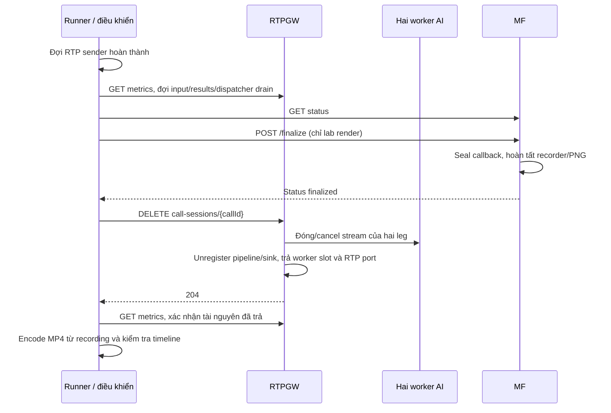

# Thiết kế E2E chạy đồng thời Segmentation và Gesture → EMOTION keyword

> **Phạm vi tài liệu:** Bản thiết kế tham khảo này được mang từ project nguồn,
> mô tả biến thể hai task AI/hai leg. Hướng dẫn áp dụng cho module đang làm việc
> nằm trong [Gesture → MF keyword của module hiện tại](video-testing.md#gesture--mf-keyword-trong-module-hiện-tại).
> Module hiện tại dùng `video.services`: `change_background` → segmentation,
> `video_effects` → gesture; mỗi dịch vụ một AI, mặc định một leg tCore và kết quả
> gửi MF tAccess. Tham khảo quy tắc mapping ở mục 6.2–6.3 của tài liệu này; không
> dùng các lệnh dual-AI, `test-gesture-keyword-e2e.sh`, `trace-gesture-keyword.py`
> hoặc artifact/evidence ngày 2026-11-08 bên dưới để chạy/khẳng định kết quả của
> module hiện tại. Những script/evidence đó thuộc project nguồn và không được
> đóng gói tại đây. Log terminal hiện tại chỉ tóm tắt START/END theo thay đổi
> gesture; các log mapping/ACK/receipt chi tiết nằm trong file.

Ngày đối chiếu mã nguồn và kiểm chứng: **2026-11-08**. Tài liệu mô tả hành vi
đang triển khai, tập trung vào RTPGW gọi trực tiếp hai worker
`../video/mediapipe` và `../video/gesture`. Chế độ AI Engine được trình bày riêng
ở mục 9.

## 1. Kết luận kiểm thử và phạm vi đã xác nhận

**Đã có E2E chạy đồng thời segmentation và gesture trên cùng cuộc gọi, ở cả
tCore và tAccess.** Hai task chạy độc lập, nhận frame từ cùng nguồn video.
Segmentation trả mask để MF ghép nền; gesture trả snapshot về RTPGW để chuẩn hóa
thành keyword `EMOTION` và gửi tới MF bằng HTTP/2.

Lần xác minh mới: **`video-e2e-UUdJ6ChY`**, video `static_gesture.mp4`,
6 giây, hai model thật bằng CPU, mode direct-worker/keyword. Kết quả
**PASS**, 1390 packet RTP, 4 RPC AI hoạt động đồng thời.

| Chỉ số của lần chạy mới | tCore | tAccess |
| --- | ---: | ---: |
| Mask segmentation | 30 | 30 |
| Snapshot gesture | 90 | 90 |
| Keyword sau mapping/dedup | 1 | 1 |
| Frame nguồn | 180 | 180 |
| Frame MF lặp lại do trễ deadline | 83 | 95 |

Đã xuất MP4 hai leg và kiểm tra PTS; mỗi file có 180 frame nguồn và 1 end marker.
Counter packet loss/jitter drop, AI input frame eviction và lỗi gửi dispatcher
không tăng; session, AI stream và RTP port được trả về baseline sau DELETE.
Chi tiết: [summary.json](evidence/gesture-segmentation-keyword-2026-11-08/summary.json), [result.json](evidence/gesture-segmentation-keyword-2026-11-08/result.json).

**Giới hạn realtime quan sát được:** MF lab lặp lại hình ở 83/180 mốc tCore
và 95/180 mốc tAccess khi compositor trễ quá deadline. Đây là `frames_dropped`
của MF playout, khác với mất packet RTP hoặc mất kết quả AI. Vì vậy PASS xác
nhận tính đầy đủ luồng chức năng/accounting và timeline MP4; chưa xác nhận
MF giữ được 30 FPS với hình mới ở mọi mốc. Lần chạy này chưa phân tách nguyên
nhân trễ theo CPU/I/O/scheduler.

Một đối chứng với worker mock đã lưu trước đó là
[`video-e2e-OPidbhde`](../tmp/keyword-compact-check/video-e2e-OPidbhde/result.json):
3 giây, 456 packet RTP, **15 mask + 45 snapshot gesture + 3 keyword mỗi leg**,
`segmentation_enabled=true`, `gesture_enabled=true`, `gesture_callback_mode=keyword`.
Đây là test truyền media/callback thật với inference mock, khác với lần kiểm
chứng hai model thật ở trên.

Phạm vi cần đọc đúng:

- Một cuộc gọi có **hai leg media**; mỗi leg có **hai task AI**. Direct-worker
  mở tổng cộng **4 RPC hai chiều**: 2 segmentation và 2 gesture. Không phải một
  leg chỉ chạy segmentation còn leg kia chỉ chạy gesture.
- Segmentation đã đi tới compositor MF và xuất MP4. Nhánh keyword đã đi tới
  receiver MF, kiểm tra nội dung/ACK và log effect tương ứng.
- `mf_cpp` hiện **log lựa chọn effect keyword**, ví dụ `congrat → fireworks`,
  với `render_mode=mock`, `rendered=false`; chưa vẽ pháo hoa lên MP4. Render
  sticker bám tay của chế độ callback gesture legacy là một đường xử lý khác.
- Runner đóng vai DCSF gửi `ANSWER` và `ctrl-result`. Lần test này không xác nhận
  tích hợp với DCSF/IMS/MRF production hoặc điều khiển H.248 trên hệ thống thật.
- Kết quả chức năng một call/hai leg chưa phải kết quả capacity/load test nhiều
  cuộc gọi, GPU failover hoặc triển khai nhiều gateway.

## 2. Thành phần, vai trò và ranh giới giao tiếp

| Thành phần | Đầu vào | Xử lý và đầu ra |
| --- | --- | --- |
| DCSF hoặc runner đóng vai DCSF | Sự kiện cuộc gọi, thông tin media resource | Chọn service; gửi ANSWER, nhận SDP/RTP endpoint; gửi resource/callback từng leg qua ctrl-result |
| MF nguồn hoặc RTP sender trong lab | File video/PCAP hoặc media cuộc gọi | Gửi H264 RTP/UDP tới các cổng RTPGW được cấp cho tCore/tAccess |
| RTPGW control plane | HTTP JSON | Tạo/đóng session, cấp cổng, chọn service profile, cập nhật resource và URL callback |
| RTPGW media pipeline | RTP H264 | Parse RTP, jitter buffer, reassemble/decode, sampling từng task, resize và encode JPEG |
| WorkerRegistry + VideoRoutingDialer | Task và capability, cấu hình endpoint/capacity | Reserve worker phù hợp; mở đúng RPC; trả slot khi stream đóng |
| `../video/mediapipe` | gRPC config + JPEG | MediaPipe segmentation, threshold foreground, encode mask RLE, trả frame identity |
| `../video/gesture` | gRPC config + JPEG | Nhận diện tĩnh/Wave, tracking từng tay, ổn định nhãn và reaction có TTL; trả snapshot |
| RTPGW result pipeline | Mask hoặc gesture protobuf | Kiểm tra kết quả, bổ sung resource; mask đi callback cũ, gesture đi normalizer keyword |
| MF callback/compositor `mf_cpp` | HTTP/2 mask và keyword | Mask được lưu rồi ghép nền; keyword được validate, chống trùng và log effect |
| Trình trace trong runner | `gateway.log`, `mf-events.jsonl` | In MAP/ACK/RECEIVED gọn, tương quan bằng key; không tham gia quyết định inference/mapping |

Endpoint mặc định của hai worker là `127.0.0.1:50052` và `127.0.0.1:50053`.
Lần kiểm chứng dùng cổng tạm thể hiện trong evidence để không đụng tiến trình
đang chạy của người dùng. Routing dựa trên task/capability, không dựa vào tên
thư mục source code.

```mermaid
flowchart LR
    C["DCSF / runner"] -->|"ANSWER, ctrl-result, DELETE"| G["RTPGW control plane"]
    S["MF nguồn / RTP sender"] -->|"H264 RTP/UDP: 2 leg"| V["Jitter + decode H264"]
    G --> V
    V -->|"sample 5 FPS, JPEG 256×256"| SQ["Segmentation input queue"]
    V -->|"sample 15 FPS, giữ aspect ratio"| HQ["Gesture input queue"]
    SQ -->|"gRPC Segment"| AI1["mediapipe worker"]
    HQ -->|"gRPC Segment"| AI2["gesture worker"]
    AI1 -->|"VideoResponse.mask"| MQ["Mask result queue + pump"]
    AI2 -->|"VideoResponse.gesture"| GQ["Gesture result queue + pump"]
    MQ --> MD["Mask dispatcher / HTTP pool"]
    GQ --> KD["Gesture FIFO / keyword normalizer / HTTP pool"]
    MD -->|"POST /results/tCore hoặc tAccess"| MF["MF receiver"]
    KD -->|"POST /contexts/.../termination/.../keyword"| MF
    MF --> R["Mask: compositor + MP4"]
    MF --> K["Keyword: log topic/info/effect"]
```



Các queue và HTTP pool tách theo task giúp một nhánh callback chậm không chiếm
worker/HTTP connection pool của nhánh còn lại. CPU, decoder, RAM, network và
process vẫn là tài nguyên chia sẻ.

## 3. Sequence điều khiển cuộc gọi

```mermaid
sequenceDiagram
    participant C as DCSF hoặc runner
    participant G as RTPGW
    participant W as WorkerRegistry
    participant S as Segmentation worker
    participant H as Gesture worker
    participant M as MF
    C->>G: POST notify-event: ANSWER, selectedService=change_background
    G->>G: Tạo call-tcore/call-taccess, cấp 2 cổng video
    loop Mỗi leg
        G->>W: Reserve video_segment và gesture_recognition
        W-->>G: Endpoint và slot từng worker
        G->>S: Mở Segment stream, gửi config segmentation
        G->>H: Mở Segment stream, gửi config gesture
    end
    G-->>C: 201 CREATED + IP, RTP port, SDP từng leg
    opt ANSWER có callbackUrl điều khiển DCSF
        G->>C: HTTP/2 CALL_CTRL, actions=duplicate, URL ctrl-result
        C->>M: Cấp/cập nhật termination và copy media theo hệ thống bên ngoài
        C-->>G: HTTP ACK của CALL_CTRL
    end
    C->>G: POST ctrl-result: mediaResources + callbackUrl/callbackUrls
    G->>G: Gắn context/termination, thay sink từng leg/task
    G-->>C: 200 + thông tin session
    Note over C,M: Lab gửi ctrl-result trực tiếp; không chạy vòng CALL_CTRL qua DCSF thật
```

### 3.1 ANSWER và lựa chọn service

Endpoint:

```http
POST /v1/vonras/call-sessions/{callId}/notify-event
Content-Type: application/json
```

`selectedService=change_background` kích hoạt segmentation. Gesture chạy thêm
khi `video.gesture.enabled=true`. `selectedService=gesture_recognition` là
gesture-only và tắt segmentation. `BEGIN` chỉ ACK; `ANSWER` mới tạo media session.
Service video-only trong cấu hình này không cấp pipeline/cổng audio.

Ví dụ **thực tế** của lần kiểm chứng:

Request `notify.json`:

```json
{
  "callId": "video-e2e-UUdJ6ChY",
  "event": "ANSWER",
  "selectedService": "change_background"
}
```

Response `201`, từ `answer.json`:

```json
{
  "session_id": "video-e2e-UUdJ6ChY",
  "status": "CREATED",
  "source_type": "raw_rtp",
  "codec": "",
  "sample_rate": 0,
  "channels": 1,
  "task": "change_background",
  "created_at": "2026-11-08T05:09:34.25379435-08:00",
  "gateway_id": "gw-video-test",
  "rtp_ip": "127.0.0.1",
  "tcore_video_rtp_port": 51716,
  "taccess_video_rtp_port": 51715,
  "tcore_local_non_dc_video_media": {
    "sdpmLine": "video 51716 RTP/AVP 96",
    "sdpaLines": [
      "rtpmap:96 H264/90000",
      "fmtp:96 packetization-mode=1;profile-level-id=42e01f",
      "sendrecv"
    ]
  },
  "taccess_local_non_dc_video_media": {
    "sdpmLine": "video 51715 RTP/AVP 96",
    "sdpaLines": [
      "rtpmap:96 H264/90000",
      "fmtp:96 packetization-mode=1;profile-level-id=42e01f",
      "sendrecv"
    ]
  }
}
```

`callId` là call ở API. Bên trong RTPGW có hai session `{callId}-tcore` và
`{callId}-taccess`. Response `session_id={callId}` là envelope call-facing,
không có nghĩa chỉ tạo một pipeline media.

### 3.2 CALL_CTRL là một nhánh điều khiển tùy chọn

`callbackUrl` ở **ANSWER** là URL của DCSF để RTPGW gọi điều khiển, không phải
URL nhận kết quả AI. Nếu có URL này, RTPGW gửi bất đồng bộ sau response ANSWER:

```http
POST <callbackUrl điều khiển do DCSF cung cấp>
Content-Type: application/json
```

```json
{
  "callId": "call-demo",
  "actions": "duplicate",
  "callbackUrl": "http://rtpgw:8081/v1/vonras/call-sessions/call-demo/ctrl-result"
}
```

Đây là **ví dụ theo code**, không phải bản tin đã bắt được trong test hiện tại.
Gateway không tự gửi H.248 Add/Modify tới MF; việc cấp termination/copy media
thuộc phía điều khiển ngoài repository. Lỗi CALL_CTRL được log và dẫn tới đóng
hai session của call. HTTP ACK CALL_CTRL và POST ctrl-result là hai trao đổi
riêng: ACK không thay cho việc cấp media resource.

### 3.3 ctrl-result và định tuyến kết quả

```http
POST /v1/vonras/call-sessions/{callId}/ctrl-result
Content-Type: application/json
```

Body **thực tế**:

```json
{
  "callId": "video-e2e-UUdJ6ChY",
  "mediaResources": {
    "tCore": {
      "contextId": "ctx-tCore",
      "termination": {
        "terminationId": "term-tCore"
      },
      "callbackUrl": "http://127.0.0.1:52833/results/tCore",
      "callbackUrls": {
        "gesture_recognition": "http://127.0.0.1:52833/nmf-mrm/v2/contexts/ctx-tCore/termination/term-tCore/keyword"
      }
    },
    "tAccess": {
      "contextId": "ctx-tAccess",
      "termination": {
        "terminationId": "term-tAccess"
      },
      "callbackUrl": "http://127.0.0.1:52833/results/tAccess",
      "callbackUrls": {
        "gesture_recognition": "http://127.0.0.1:52833/nmf-mrm/v2/contexts/ctx-tAccess/termination/term-tAccess/keyword"
      }
    }
  }
}
```

Gateway cập nhật từng session với đúng một phía `tCore` hoặc `tAccess`:

1. Lấy `contextId` và `termination.terminationId` làm resource của session.
2. `callbackUrl` trong resource là URL kết quả chung của leg, dùng cho mask.
3. `callbackUrls.gesture_recognition` override riêng HTTP sink của gesture.
4. Khi chuẩn hóa keyword, context/termination đi vào URL; không còn nằm trong
   body JSON hai trường.

Tên JSON là **`callbackUrls`**, task override là **`gesture_recognition`** hoặc
**`video_segment`**. Không dùng `segmentation` làm key override mặc dù cấu hình
worker protobuf có `ai_service=segmentation`.

API control plane dùng HTTP JSON; server hỗ trợ h2c. Runner lab gọi các API này
bằng curl thông thường. Không suy từ đó rằng mọi bản tin signaling của test đã
được bắt trên HTTP/2. Nhánh callback RTPGW → MF được kiểm tra HTTP/2 riêng.

## 4. Sequence xử lý media và hai nhánh AI

```mermaid
sequenceDiagram
    participant P as MF nguồn / RTP sender
    participant G as RTPGW media pipeline
    participant S as Segmentation worker
    participant H as Gesture worker
    participant N as RTPGW result / normalizer
    participant M as MF callback + compositor
    P->>M: Lab: chuẩn bị spool frame và POST /start/{leg}
    loop H264 RTP ở 30 FPS, mỗi leg
        P->>G: RTP packet, sequence, timestamp, marker
        G->>G: Jitter, reassemble, decode thành frame nguồn
        par Segmentation được sample 5 FPS
            G->>S: VideoRequest.frame: JPEG 256x256 + frame identity
            S->>S: Segmenter, threshold, RLE
            S-->>N: VideoResponse.mask
            N->>M: HTTP/2 POST video.mask.result
            M->>M: Validate, lưu mask theo frame/timestamp
            M-->>N: 200 ACK sau khi lưu
        and Gesture được sample 15 FPS
            G->>H: VideoRequest.frame: JPEG giữ aspect ratio + identity
            H->>H: Recognizer, tracking, static/Wave, reaction TTL
            H-->>N: VideoResponse.gesture, kể cả hands rỗng
            N->>N: Validate, mapping, coalesce và dedup event
            opt Có keyword mới cần gửi
                N->>M: HTTP/2 POST keyword + Idempotency-Key
                M->>M: Validate, dedup key, log topic/info/effect
                M-->>N: 200 ok/duplicate
            end
        end
        M->>M: Playout chọn mask hợp lệ trước deadline; render video nguồn
    end
    Note over S,H: Không có barrier bắt hai task trả cùng frame_id hoặc cùng thời điểm
```

### 4.1 RTPGW nhận RTP và chia frame

- Media transport là **H264 trong RTP/UDP**, trong profile lab dùng PT 96 và
  clock 90 kHz. IP/port lấy từ response ANSWER; không gửi JPEG tới cổng RTP này.
- Jitter buffer xử lý thứ tự/duplicate/loss; pipeline reassemble các packet
  thành dữ liệu H264 rồi decoder tạo frame nguồn.
- Một decoder phục vụ fan-out của từng leg. Hai sampler quyết định độc lập
  frame nào được gửi segmentation hoặc gesture.
- Segmentation resize theo kích thước inference, thường 256×256 ở 5 FPS.
  Gesture giữ aspect ratio, giới hạn cạnh dài 640, thường 15 FPS.
- `frame_id` và RTP timestamp giữ quan hệ với frame nguồn; `seq` của kết quả
  gesture là bộ đếm response riêng, không đồng nhất với frame ID nguồn.

30 FPS nguồn trong 6 giây tạo 180 frame/leg. Profile 5/15 FPS thường tạo 30 JPEG
segmentation và 90 JPEG gesture/leg. Đây là 120 lần xử lý task trên mỗi leg,
không phải 120 frame output video. Những con số thực tế xem mục 1.

### 4.2 RPC và routing

Hai worker direct dùng cùng RPC hai chiều:

```proto
rpc Segment(stream VideoRequest) returns (stream VideoResponse);
// Full method: /video.VideoStream/Segment
```

`video.ai.workers` khai báo capability `video`, `jpeg`, protocol `video_segment`
và task `video_segment`/`gesture_recognition`. Registry reserve slot trước khi
mở RPC; chọn nhầm task/capacity sẽ bị từ chối. Reservation là trạng thái trong
gateway, không phải quota phân tán giữa nhiều gateway.

Mỗi RPC gửi config một lần trước các frame. Các ví dụ ở mục 5 là **cách diễn
giải protobuf bằng JSON để đọc**, không phải HTTP JSON trên đường AI. Transport
thực là gRPC/protobuf; `image_data` là bytes JPEG.

## 5. Contract RTPGW ↔ worker

### 5.1 Config đầu stream

Ví dụ segmentation direct theo các trường thực được dialer hiện tại gửi:

```json
{
  "session_id": "call-demo-tcore",
  "stream_id": "call-demo-tcore",
  "config": {
    "ai_service": "segmentation",
    "input_format": "jpeg",
    "effect_type": "bg_replace",
    "inference_width": 256,
    "inference_height": 256,
    "inference_fps": 5,
    "threshold": 0
  }
}
```

`threshold=0` chọn ngưỡng mặc định của worker. Ở đường direct hiện tại,
segmentation dialer không gắn `selected_service`/`media_epoch` vào config này.

Ví dụ gesture trên RPC riêng:

```json
{
  "session_id": "call-demo-tcore",
  "stream_id": "call-demo:tcore:video",
  "config": {
    "selected_service": "change_background",
    "ai_service": "gesture_recognition",
    "media_epoch": "media-demo",
    "input_format": "jpeg",
    "inference_width": 0,
    "inference_height": 0,
    "inference_fps": 15,
    "max_hands": 4
  }
}
```

Direct gesture kiểm tra kích thước từng JPEG, nên config dimensions có thể 0;
gateway đã giới hạn cạnh ảnh ở pipeline. Không áp dụng cách diễn giải này cho
SourceOpen của Engine, nơi cạnh dài gesture nằm trong task config.

### 5.2 Frame gửi inference

Ví dụ frame gesture, sử dụng số minh họa:

```json
{
  "session_id": "call-demo-tcore",
  "stream_id": "call-demo:tcore:video",
  "frame": {
    "frame_id": 61,
    "rtp_timestamp": 1180000,
    "extended_rtp_timestamp": 1180000,
    "timestamp_ms": 2000,
    "original_width": 640,
    "original_height": 360,
    "width": 640,
    "height": 360,
    "encoding": "jpeg",
    "image_data": "<JPEG bytes; không hiển thị trong tài liệu>"
  }
}
```

| Trường | Công dụng |
| --- | --- |
| `session_id`, `stream_id` | Xác định leg và RPC/task tương ứng |
| `frame_id` | Liên kết kết quả với frame đã gửi |
| `rtp_timestamp` | Timestamp 32-bit của video nguồn; dùng ghép với frame MF |
| `extended_rtp_timestamp` | Timestamp mở rộng để xử lý wrap; không phải Unix time |
| `timestamp_ms` | Media time của frame, không phải thời điểm HTTP nhận kết quả |
| `original_width/height` | Kích thước source trước resize |
| `width/height` | Kích thước JPEG thực tế gửi AI |
| `image_data` | Dữ liệu ảnh JPEG, không phải H264/RTP hay ảnh đã có effect |

### 5.3 Worker segmentation xử lý và trả mask

Worker kiểm tra config, task, kích thước JPEG và identity của stream. JPEG được
decode thành ảnh, đưa vào MediaPipe ImageSegmenter; confidence mask được threshold
thành foreground nhị phân rồi encode RLE. Kết quả là `VideoResponse.mask`, gồm
`frame_id`, `rtp_timestamp`, `mask_width/height`, `rle_counts`, `status` và latency.
Worker không trả ảnh đã thay nền; MF thực hiện ghép với source.

RLE luân phiên run background/foreground, bắt đầu với background; tổng run phải
bằng `mask_width * mask_height`. Mỗi frame lỗi có thể mang mask `status=error`
và `error_message`; RTPGW không coi đó là mask hợp lệ để render.

Ví dụ cấu trúc minh họa ngắn cho mask 2×2, không phải kết quả model thực:

```json
{
  "session_id": "call-demo-tcore",
  "stream_id": "call-demo-tcore",
  "is_final": true,
  "mask": {
    "frame_id": 61,
    "rtp_timestamp": 1180000,
    "mask_width": 2,
    "mask_height": 2,
    "rle_counts": [1, 2, 1],
    "status": "ok",
    "latency_ms": 12.5
  }
}
```

`is_final=true` được dùng cho kết quả mask từng frame trong đường hiện tại;
không phải lệnh kết thúc cuộc gọi và không yêu cầu MF finalize.

### 5.4 Worker gesture xử lý và trả snapshot

Worker giữ recognizer/tracker riêng cho mỗi RPC. MediaPipe nhận diện nhãn thô;
bộ lọc ổn định xác nhận gesture tĩnh; Wave dùng chuyển động landmark theo thời
gian. `track_id` duy trì định danh tay, còn ReactionState giữ reaction còn hiệu
lực và event ID tương ứng.

Ví dụ cấu trúc minh họa cho raw Open_Palm nhưng đã xác nhận Wave:

```json
{
  "session_id": "call-demo-tcore",
  "stream_id": "call-demo:tcore:video",
  "ai_service": "gesture_recognition",
  "seq": 31,
  "is_final": false,
  "gesture": {
    "media_epoch": "media-demo",
    "recognizer_epoch": "recognizer-demo",
    "response_id": "recognizer-demo/31",
    "frame_id": 61,
    "rtp_timestamp": 1180000,
    "extended_rtp_timestamp": 1180000,
    "timestamp_ms": 2000,
    "original_width": 640,
    "original_height": 360,
    "status": "ok",
    "hands": [{
      "track_id": 1,
      "handedness": "Right",
      "raw_label": "Open_Palm",
      "raw_score": 0.72,
      "stable_label": "",
      "center": [0.5, 0.55],
      "bbox": [0.4, 0.35, 0.6, 0.7],
      "active_reaction": {
        "event_id": "wave-demo-1",
        "gesture": "Wave",
        "emoji_key": "wave",
        "started_at_ms": 2000,
        "valid_until_ms": 3500
      }
    }]
  }
}
```

Tọa độ là normalized theo source; `bbox=[xmin,ymin,xmax,ymax]`.
21 landmark không đi trong contract trả về này. `hands=[]` vẫn là snapshot hợp
lệ và được trả về, giúp thể hiện trạng thái hiện tại không có tay/reaction.

RTPGW direct gesture đối chiếu session/stream/service, media epoch, frame đang
chờ, RTP/extended timestamp, media time, dimensions và giới hạn tay. Payload
không khớp nguồn bị từ chối; gateway không tự chạy lại model để sửa kết quả.

## 6. Contract RTPGW → MF và xử lý tại MF

### 6.1 Segmentation callback vẫn mang mask

```http
POST /results/tCore
Content-Type: application/json
```

Trích **thực tế**, đã bỏ mảng RLE dài khỏi phần hiển thị; body đầy đủ, hợp lệ để
gửi lại nằm trong `messages.json` của evidence:

```json
{
  "contextId": "ctx-tCore",
  "event_type": "video.mask.result",
  "is_final": true,
  "kind": "video_mask",
  "mediaResources": {
    "tCore": {
      "contextId": "ctx-tCore",
      "terminationId": "term-tCore"
    }
  },
  "seq": 0,
  "session_id": "video-e2e-UUdJ6ChY-tcore",
  "source_type": "raw_rtp",
  "stream_id": "video-e2e-UUdJ6ChY-tcore",
  "terminationId": "term-tCore",
  "text": "",
  "ts_end": 0,
  "ts_start": 0,
  "video_mask": {
    "frame_id": 1,
    "latency_ms": 99.91957,
    "mask_height": 256,
    "mask_width": 256,
    "rtp_timestamp": 1210808816,
    "status": "ok"
  }
}
```

`mediaResources` trong callback là resource đã được flatten thành
`contextId/terminationId`, khác với `termination: {terminationId}` trong
ctrl-result. `text`, `ts_start/end`, `seq` thuộc envelope dùng chung; correlation
mask phải dùng frame ID/timestamp trong `video_mask`.

MF kiểm tra event/kind, session/stream đúng leg, resource, status, dimensions và
RLE. Khi render mode bật, MF còn kiểm tra frame/timestamp có trong manifest
source. Mask hợp lệ được lưu trước ACK; xử lý decode/render/ghi PNG chạy ở luồng
playout/recorder, không chạy trực tiếp trong callback HTTP.

ACK **thực tế** của mask trên:

```json
{
  "accepted_at_ms": 234,
  "duplicate": false,
  "frames_written": 0,
  "gesture_render_mode": "realtime",
  "playout_media_at_receive_ms": 0,
  "queued": true,
  "realtime": true,
  "receive_lag_ms": 234,
  "source_media_ms": 0
}
```

`queued=true`/HTTP 200 xác nhận đã nhận/lưu; `frames_written` là tiến độ recorder,
không chứng minh frame của callback này đã render xong.

### 6.2 Gesture được chuyển thành keyword tại RTPGW

Normalizer dùng `active_reaction.gesture` và event ID, thay vì chỉ lấy nhãn thô.
Mapping mặc định là cấu hình nghiệp vụ:

| Gesture | topic_label | topic_info | Effect MF mock chọn để log |
| --- | --- | --- | --- |
| Wave | EMOTION | congrat | fireworks |
| Thumb_Up | EMOTION | approve | thumbs_up |
| Thumb_Down | EMOTION | disapprove | thumbs_down |
| Victory | EMOTION | celebrate | confetti |
| ILoveYou | EMOTION | love | hearts |
| Closed_Fist | EMOTION | determination | sparks |
| Open_Palm | EMOTION | hello | greeting |
| Pointing_Up | EMOTION | attention | highlight |

Lần chạy model thật mới ghi nhận `Thumb_Up → EMOTION/approve`. Bảng trên mô tả
mapping hiện có trong code; không phải tuyên bố video này đã kiểm chứng nhận
diện thực tế đủ cả tám gesture.

`None`, không có tay và nhãn chưa map không phát keyword. Open_Palm là nhãn tĩnh
model hỗ trợ nhưng worker dùng cho Wave và không phát static reaction riêng;
gateway fallback xác nhận ít nhất 3 mẫu trong 200 ms, score ≥ 0.6, reset khi mất
tay/chuyển nhãn hoặc gap > 500 ms. Reaction AI có ưu tiên hơn fallback này.
Thay mapping tại `callback.gesture_keywords.mapping` không cần đổi worker.

Quy tắc gửi:

1. Chuẩn hóa snapshot đã hợp lệ; bỏ snapshot cũ hơn source time đã xử lý.
2. Chọn reaction còn hiệu lực, map gesture thành topic/info. Các tay cùng keyword
   trong một snapshot được coalesce; keyword khác nhau thành request riêng.
3. Chống lặp theo destination, session/epoch, track, event và keyword. Chỉ đánh
   dấu đã gửi sau ACK 2xx; snapshot mới có thể thử lại event chưa gửi thành công.
4. Tạo `Idempotency-Key` bằng SHA-256 từ danh tính sự kiện, giữ nguyên qua retry.
5. Callback gesture dùng FIFO có affinity theo session và HTTP pool riêng. Retry
   đồng bộ trong request giữ thứ tự gửi của session đó.

Một event xuất hiện ở nhiều snapshot không tạo effect mới ở mỗi frame. Cache
gateway giới hạn 4096 key theo sink; đây là chống trùng có giới hạn bộ nhớ,
không phải cam kết exactly-once vô hạn hay qua restart gateway.

### 6.3 POST keyword và MF nhận thực tế

Request thực từ `gateway.log`, cùng key với receipt MF bên dưới:

```http
POST http://127.0.0.1:52833/nmf-mrm/v2/contexts/ctx-tAccess/termination/term-tAccess/keyword
Content-Type: application/json
Idempotency-Key: 0708da65eb96c21bf9149355f65e3ff5b5c6653b3ab488b15f6ccf3ed0903af1
```

```json
{
  "topic_label": "EMOTION",
  "topic_info": "approve"
}
```

Log ACK thực tại RTPGW:

```json
{
  "level": "info",
  "ts": "2026-11-08T05:10:01.233713-08:00",
  "caller": "result/http_callback.go:341",
  "msg": "keyword: http response",
  "session_id": "video-e2e-UUdJ6ChY-taccess",
  "idempotency_key": "0708da65eb96c21bf9149355f65e3ff5b5c6653b3ab488b15f6ccf3ed0903af1",
  "attempt": 1,
  "status": 200,
  "protocol": "HTTP/2.0"
}
```

Log nhận thực tại MF:

```json
{
  "contextId": "ctx-tAccess",
  "effect": "thumbs_up",
  "event": "keyword_received",
  "idempotency_key": "0708da65eb96c21bf9149355f65e3ff5b5c6653b3ab488b15f6ccf3ed0903af1",
  "path": "/nmf-mrm/v2/contexts/ctx-tAccess/termination/term-tAccess/keyword",
  "protocol": "HTTP/2.0",
  "render_mode": "mock",
  "rendered": false,
  "terminationId": "term-tAccess",
  "topic_info": "approve",
  "topic_label": "EMOTION"
}
```

Body gửi trên wire có **đúng hai trường** `topic_label` và `topic_info`.
Không gửi `hands`, bbox, center, JPEG, timestamp hay `mediaResources` trong body;
resource nằm trong URL. Đây là route/contract keyword đang tích hợp, không phải
xác nhận triển khai đầy đủ mọi API Nmf_MRM của một MF production.

Trong MF mock:

1. Parse context/termination từ URL; yêu cầu POST và hai chuỗi không rỗng.
2. Nếu có idempotency key, kiểm tra theo context/termination/key. Cùng key cùng
   body trả 200 duplicate; cùng key khác body trả 409.
3. Chọn tên effect từ topic/info và ghi `keyword_received` trước ACK.
4. Trả body theo code `{"ok":true,"duplicate":false}` cho event mới hoặc
   `{"ok":true,"duplicate":true}` cho retry trùng. Đây là ví dụ response theo
   implementation; gateway hiện log status/protocol, không lưu body ACK keyword.

Cache MF mock tối đa 4096 key trong 5 phút. Keyword không biết vẫn được log với
`effect=unmapped`. JSON sai trả 400, route sai trả 404, method sai trả 405.

### 6.4 Đường render source/mask trong lab

`mf_cpp` là receiver HTTP/2 và compositor lab; **không tự nhận RTP nguồn**.
`mock-video-rtp-sender` chuẩn bị `frames.json` và `frames.rgba` trong thư mục
chung của từng leg, POST `/start/tCore` hoặc `/start/tAccess` rồi phát RTP.
MF đọc source từ spool này. Đây là adapter kiểm thử thay cho việc MF production
đã có luồng media nguồn của mình.

Ở mode realtime, với frame nguồn tại T:

```text
deadline = T + playout_delay_ms (mặc định 300 ms)
eligible mask: source timestamp <= timestamp frame cần ghép
               và đã được nhận/lưu trước deadline
chọn mask mới nhất trong eligible, còn tuổi <= mask_max_age_ms (500 ms)
```

MF resize mask về source rồi ghép foreground/source với background. Mask thiếu,
quá tuổi hoặc đến muộn làm MF dùng source/fallback theo scheduler; không sửa
frame đã xuất. Keyword là event control riêng, không phải một mask hoặc barrier
để compositor đợi. Body keyword chưa có vị trí/TTL/media time; triển khai effect
thật sau này phải có chính sách vị trí/thời lượng ở MF hoặc mở rộng contract.

## 7. Tương quan, concurrency, retry và lỗi

| Khái niệm | Phạm vi và công dụng |
| --- | --- |
| `callId` | Điều khiển chung cuộc gọi |
| `session_id` | Pipeline một leg, dạng call-tcore/call-taccess |
| `stream_id` | Segmentation direct dùng session; gesture dùng canonical call:leg:video |
| `frame_id`, RTP timestamp | Liên kết inference với source frame; hai task có thể sample khác nhau |
| `media_epoch` | Phân biệt vòng đời media của gesture/source |
| `recognizer_epoch` | Vòng đời tracker/recognizer trong worker gesture |
| `response_id` | Định danh snapshot, không phải event effect |
| `track_id`, `event_id` | Tay được theo dõi và reaction đang hoạt động |
| `Idempotency-Key` | Tương quan POST/ACK/MF receipt và chống retry kích hoạt lại |

Mỗi leg có queue/pump mask và gesture riêng. Dispatcher có các lane
default/audio, mask và gesture; keyword mode chia gesture FIFO theo hash session,
mỗi FIFO có một consumer. Session khác có thể cùng shard nên vẫn có thể chờ nhau;
đây không phải cách ly tài nguyên tuyệt đối cho mọi call. HTTP/2 pool mask và
gesture độc lập dù cùng MF host.

| Sự kiện | Hành vi hiện tại |
| --- | --- |
| HTTP 2xx | Hoàn thành gửi; gateway ghi delivered/dedup event |
| HTTP 4xx | Không retry; log lỗi; 409 của keyword cho biết xung đột key/body |
| HTTP 5xx hoặc lỗi mạng | Retry có timeout và backoff cấu hình; giữ nguyên key/body |
| Hết retry | Trả lỗi cho dispatcher; nếu có dead-letter sink thì chuyển tới sink đó |
| Mask/gesture callback chậm | Không chiếm worker pool của task còn lại; vẫn chia sẻ CPU/network/process |
| No-hand hoặc event lặp | Không có POST keyword mới; không phải lỗi mất bản tin |
| Queue đầy | Bounded queue và chính sách block/drop theo cấu hình; runner tắt drop partial ở dispatcher và kiểm tra counter drop |
| ENODATA khi đọc trace trên WSL | Trace thử lại từ byte đã commit, ghi cảnh báo trong keyword-trace.log |

Không đồng nhất các timeout: AI inference timeout, gRPC send/result timeout,
HTTP timeout mỗi attempt, deadline tổng dispatcher, drain timeout và deadline
playout MF có mục đích khác nhau. Runner tính deadline dispatcher theo ngân sách
retry của một request HTTP. Snapshot tạo nhiều keyword vẫn chia sẻ deadline của
lần dispatch; cần tính thêm fan-out này khi tune cho callback chậm. Tăng HTTP
timeout riêng lẻ không bảo đảm kết quả còn kịp render frame nguồn.

## 8. Kết thúc cuộc gọi và tiêu chí PASS



Protocol AI hỗ trợ `is_eos=true` không có config/frame hoặc half-close để drain
công việc đã nhận. Không dùng `VideoResponse.is_final` của mask để đóng call.
Trong lab, runner đã đợi đủ kết quả trước DELETE; đóng session/cancel giải phóng
stream. `/start`, `/status`, `/finalize` là endpoint phụ trợ lab, không phải API
điều khiển MF production mà lần kiểm chứng đã xác nhận.

PASS của runner kiểm tra đồng thời:

- Packet sender khớp các counter ingress/jitter/decode, không tăng lỗi/drop/loss
  không được cho phép; cấu hình external cho phép một số frame eviction ở input
  nhưng vẫn kiểm tra accounting và coverage kết quả.
- Mask đúng leg/resource, frame identity, dimensions/RLE; đủ số lượng và coverage.
- Snapshot gesture được đếm riêng, kể cả không có tay hoặc đã dedup keyword.
- Mỗi keyword nhận tại MF khớp body đã POST, có bằng chứng source/mapping, ACK
  HTTP/2 2xx và key tương ứng; không coi chỉ có log gửi là thành công.
- AI input/results, dispatcher và queue đã drain; không tăng send error.
- DELETE trả tài nguyên: session, AI stream/pipeline và RTP port về baseline.
- Khi bật output video, MF finalized và MP4 PTS/timeline khớp frame nguồn. Concat
  có thể thêm một end-marker frame; đó không phải một frame inference mới.

## 9. Chế độ AI Engine thay cho direct-worker

Code còn hỗ trợ `video.ai.engine_target`. Trong chế độ này:

```text
RTPGW -- một VideoAIService.Process/source RPC mỗi leg --> video-ai-engine
       -- SourceOpen + JPEG nguồn --> Engine fan-out hai task
Engine -- Segment/config/frame --> mediapipe và gesture worker
Engine -- SourceResponse.result --> RTPGW --> mask callback / keyword --> MF
```

`SourceOpen` chọn các task bằng presence của `segmentation`/`gesture`, mang
session/stream/media epoch và input profile. Engine trả `opened.max_inflight`,
`accepted.frame_id` để điều khiển credit; accepted là đã nhận vào queue, không
phải inference hoàn tất. `result` là kết quả độc lập từng task, không đợi đủ hai
kết quả cùng frame. `task_status` báo lỗi task và không biến thành callback MF.

Hai mode có cùng kiểu kết quả sau khi vào pipeline RTPGW, nhưng accounting
input khác nhau: Engine nhận một JPEG nguồn có thể tạo nhiều task result;
direct-worker gửi JPEG được sample/resize riêng từng task. Không cấu hình đồng
thời `engine_target` và `workers/grpc_target`. Lần xác minh keyword mới trong
mục 1 là **direct-worker**; không dùng nó để suy rằng mọi tổ hợp Engine/keyword
đã được kiểm thử production.

## 10. Cấu hình và tái lập

Profile `gateway-video-keyword.yaml` trong phần này thuộc bản thiết kế nguồn.
Module hiện tại dùng [`gateway-video-ims.yaml`](../config/gateway-video-ims.yaml)
và cách chạy lab trong [video-testing.md](video-testing.md).
Những tham số cốt lõi:

```yaml
video:
  enabled: true
  infer_width: 256
  infer_height: 256
  infer_fps: 5
  gesture:
    enabled: true
    infer_fps: 15
    max_dimension: 640
    max_hands: 4
  ai:
    workers:
      - id: segmentation
        grpc_target: '127.0.0.1:50052'
        tasks: [video_segment]
        max_streams: 8
      - id: gesture
        grpc_target: '127.0.0.1:50053'
        tasks: [gesture_recognition]
        max_streams: 4
callback:
  gesture_keywords:
    mode: keyword
    base_url: 'http://127.0.0.1:9999'
```

Đoạn YAML là phần trích, không thay thế toàn bộ profile. Capacity phải khớp
worker/recognizer thực tế. URL keyword đầy đủ của task được ưu tiên nếu có và
phải khớp context/termination. Với callback cũ, gateway dựng keyword path từ
base_url hoặc origin của callback; base_url chỉ là scheme/host/port.

Sau khi hai worker thật đã sẵn sàng, chạy từ root repository:

```bash
bash scripts/test-gesture-keyword-e2e.sh \
  --ai-target 127.0.0.1:50052 \
  --gesture-target 127.0.0.1:50053 \
  --input data/gesture_sample/static_gesture.mp4 \
  --duration 6 --artifacts-dir tmp/gesture-segmentation-e2e
```

Không truyền endpoint thì runner dùng worker mock. `--no-output-video` bỏ PNG/
MP4, vẫn kiểm tra mask/keyword trên mạng. `--bin-dir` tái sử dụng các binary đã
build; `--mf-bin` chỉ tái sử dụng MF. Runner tự tạo gateway/MF/sender và tự đóng
chúng; worker external có sẵn không bị runner dừng.

Log ngắn nên đọc theo thứ tự nghiệp vụ và key, không dựa vào thứ tự hai file
được tail:

```text
[RTPGW][MAP] leg=tAccess frame=131 gesture=Thumb_Up hand=4 raw=Thumb_Up score=0.65 EMOTION/approve id=0708da65
[MF][RECEIVED] leg=tAccess frame=131 gesture=Thumb_Up EMOTION/approve id=0708da65
[RTPGW][ACK] leg=tAccess frame=131 gesture=Thumb_Up EMOTION/approve status=200 id=0708da65
[RTPGW][MAP] leg=tCore frame=131 gesture=Thumb_Up hand=4 raw=Thumb_Up score=0.65 EMOTION/approve id=a1818f50
[RTPGW][ACK] leg=tCore frame=131 gesture=Thumb_Up EMOTION/approve status=200 id=a1818f50
[MF][RECEIVED] leg=tCore frame=131 gesture=Thumb_Up EMOTION/approve id=a1818f50
```

`test.log` lưu các bước chạy; `gateway.log` có source identity ngắn, mapping và
HTTP request/status; `mf-events.jsonl` là receipt/ACK metadata của MF;
`keyword-trace.jsonl` chỉ có MAP/ACK/RECEIVED gọn. `keyword-trace.log` chứa lỗi
trình đọc. Trace không quyết định mapping, không tự dựng receipt giả từ log gửi.

## 11. Nguồn kiểm chứng và vị trí mã nguồn

Bộ evidence gọn được giữ trong repository tại [evidence/gesture-segmentation-keyword-2026-11-08/](evidence/gesture-segmentation-keyword-2026-11-08/summary.json):

- [summary.json](evidence/gesture-segmentation-keyword-2026-11-08/summary.json): counters, concurrency, cleanup và frame lặp.
- [messages.json](evidence/gesture-segmentation-keyword-2026-11-08/messages.json): request/response và dòng nguồn từng trích đoạn; mask RLE đầy đủ.
- [signaling.json](evidence/gesture-segmentation-keyword-2026-11-08/signaling.json), [gateway-config.json](evidence/gesture-segmentation-keyword-2026-11-08/gateway-config.json): control plane và profile thật.
- [test.log](evidence/gesture-segmentation-keyword-2026-11-08/test.log), [keyword-trace.jsonl](evidence/gesture-segmentation-keyword-2026-11-08/keyword-trace.jsonl): trace MAP/ACK/RECEIVED thực.
- [worker-log-excerpts.txt](evidence/gesture-segmentation-keyword-2026-11-08/worker-log-excerpts.txt), [manifest.json](evidence/gesture-segmentation-keyword-2026-11-08/manifest.json): model thật, lệnh chạy và fingerprint source/model.

Artifacts gốc và MP4 tại [`tmp/design-gesture-segmentation-2026-11-08/video-e2e-UUdJ6ChY/`](../tmp/design-gesture-segmentation-2026-11-08/video-e2e-UUdJ6ChY/result.json). Các file lớn trong `tmp/` có thể được dọn; evidence gọn ở trên giữ lại các dữ kiện cần để đối chiếu tài liệu.

Các block được ghi **minh họa/theo code** ở mục 3 và 5 không phải packet capture.
Các block ghi **thực tế** được trích từ artifacts/log, có source file/line trong
`messages.json`. Riêng mask request đã loại trường log nội bộ MF `event/path/
protocol/render`; `render` được trình bày riêng làm ACK metadata, không phải
field RTPGW gửi sang MF.

| Nội dung | Mã nguồn |
| --- | --- |
| ANSWER, ctrl-result, DELETE, CALL_CTRL tùy chọn | [handler.go](../internal/controlplane/handler.go), [dcsf_client.go](../internal/controlplane/dcsf_client.go) |
| Tạo pipeline hai task, resource/result pumps | [coordinator.go](../internal/coordinator/coordinator.go) |
| Worker capability/route | [video_workers.go](../internal/config/video_workers.go), [video_grpc_dialer.go](../internal/ai/video_grpc_dialer.go) |
| Proto nguồn và identity validation | [video.proto](../internal/ai/proto/video.proto), [video_task_dialer.go](../internal/ai/video_task_dialer.go) |
| Chuẩn hóa keyword/dedup/FIFO/HTTP2 | [gesture_keyword.go](../internal/result/gesture_keyword.go), [dispatcher.go](../internal/result/dispatcher.go), [http_callback.go](../internal/result/http_callback.go) |
| MF keyword validate/log và mask renderer | [keyword_receiver.cpp](../mf/src/keyword_receiver.cpp), [callback_server.cpp](../mf/src/callback_server.cpp), [renderer.cpp](../mf/src/renderer.cpp) |
| Worker segmentation | [segmenter.py](../../video/mediapipe/src/mediapipe_video/segmenter.py) |
| Worker gesture | [server.py](../../video/gesture/src/server.py), [gesture_events.py](../../video/gesture/src/gesture_events.py) |
| Runner và phép kiểm chứng E2E | [test-gesture-keyword-e2e.sh](../scripts/test-gesture-keyword-e2e.sh), [test-video-e2e.sh](../scripts/test-video-e2e.sh) |
| Log ngắn và phục hồi ENODATA | [trace-gesture-keyword.py](../scripts/trace-gesture-keyword.py) |
